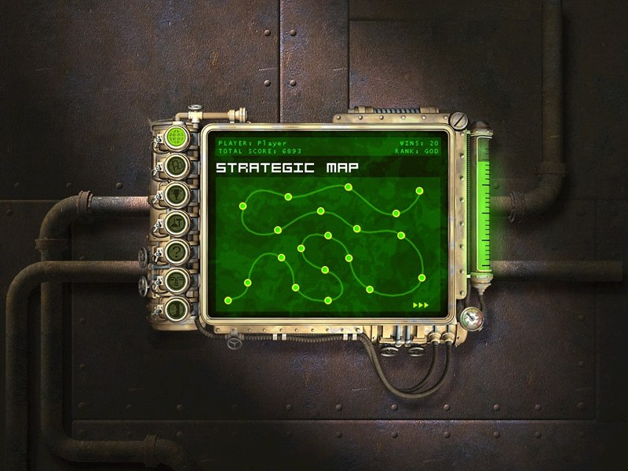
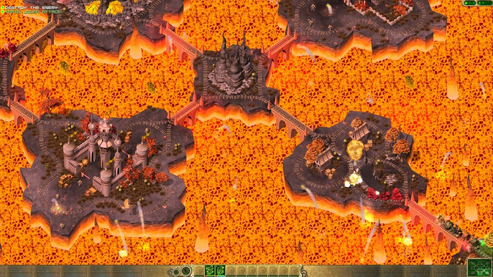

# OpenLocoland

**Locoland** (Gromada, 2003) is a little-known strategy game about armed trains: you lay track,
send out locomotives with cannons and rocket launchers, and drive the invaders out of a land of
living trains. **OpenLocoland** brings it back to today's Windows: it runs in a window or on full
screen in any resolution, plays well on a wide screen, keeps your progress, fixes some of the old crashes and bugs - and it
has a **map editor inside the game** (work in progress), so you can make your own missions and share
them with friends.

It is a fan project, not affiliated with the makers of Locoland. It does not contain the game: you
need your own copy of [Locoland from Steam](https://store.steampowered.com/app/352130/Locoland/),
and OpenLocoland is put together from it on your computer. Your Steam game stays untouched.

## What you get

- **The game as it was, on current Windows.** A window or full screen, every resolution up to 4K,
  more of the map on a wide screen, a steady 60 frames a second, the mouse right on any monitor.
- **Some of the old bugs fixed.** Crashes in some missions and in the repair point, sounds that
  were missing, a car the factory could never build, the profile that was never saved - others are
  still open ([BUGS.md](BUGS.md)).
- **Your progress is kept.** Missions won, scores and settings stay, and the ones from the original
  game are carried over.
- **Custom maps.** A second page on the strategic map, with **POLIGON** - a ready mission to try -
  and every map you make or get from a friend.
- **A map editor (work in progress).** The authors' own editor mode, left inside the game and never
  shown to players, brought back and built out: ground, water and lava, track that snaps the way the game drives it,
  factories, repair points, forts with their guns, armies and their flags, trains, enemy patrols,
  the mission's texts. Press "Play the map" and you are in it. Maps go to friends as one file.
- **Two extras, off by default**: the developers' cheat keys and all missions open from the start
  (your real progress is not touched).
- **Languages**: English, German, Hungarian, Polish and Russian, the game's own translations with
  their gaps filled, and Czech from a fan translation (unofficial). The game and the installer follow your
  Windows language and fall back to English.

## Pictures

| | |
|---|---|
|  |  |
| The campaign: 20 missions on the strategic map | A battle over the lava at 1920 x 1080 |
|  |  |
| The custom maps page with the editor on top | The editor: a factory on its track |
|  |  |
| Every object of the game to place | A fort and the gun in each socket |
|  |  |
| A new map of any size | Help pages inside the editor |

## Installing

1. Install Locoland through Steam (any language).
2. Download `Setup.exe` from [Releases](https://github.com/Dysprohol/OpenLocoland/releases) and run
   it (Windows may warn about an unknown publisher: "More info" > "Run anyway"). It finds the
   Steam game and installs OpenLocoland into a folder of its own; you choose the language and the
   two extras there.
3. Start **Locoland** or **Locoland - map editor** from the desktop or the Start menu.

Running a newer `Setup.exe` updates the game and keeps your maps, scores and progress. The
player's guide tells the rest, the editor with a step-by-step first mission included:
[GUIDE.md](docs/GUIDE.md) (English), [PRZEWODNIK.md](docs/PRZEWODNIK.md) (Polish).

This is a test version: bugs and ideas are welcome in
[Issues](https://github.com/Dysprohol/OpenLocoland/issues).

## How it was made

Nobody has the source code of Locoland, so the work started with the program itself. The 2003
`Locoland.exe` was taken apart with the [Ghidra](https://ghidra-sre.org/) decompiler, and step by
step every one of the engine's 993 functions got a name and a description: how the trains drive,
how a map is stored, how the mission scripts run. The fixes are written in C++ in `LocoFix.dll`,
which the original program loads at start, so the game stays itself and keeps working at every
step. Graphics go through [dgVoodoo2](http://dege.freeweb.hu/dgVoodoo2/), which turns the old
DirectX 7 into something today's Windows draw properly.

Along the way the authors' own map editor turned up inside the engine - the mode they made the
campaign with, switched off in the game they sold. OpenLocoland switches it back on and builds the
rest around it: the bar, the tools and the help in the look of the game.

## Plans

- **Multiplayer.** The engine already lists network functions for its mission scripts, but the
  authors never wrote them. The goal is to play with or against a friend.
- **New missions.** Our own missions and an alternative campaign made in the editor, next to the
  original twenty.
- **More fixes and polish.** The bugs still open in [BUGS.md](BUGS.md), the interface scaled up on
  big screens, the editor tried in full screen, and whatever turns up while playing.
- **The engine in readable code.** The understood parts of the engine rewritten in C++ one by one,
  so the game can grow past the limits of the original program.
- **A public release**, ideally with the blessing of the rights holders.

## For developers

- [DEVELOPERS.md](DEVELOPERS.md) - building from the repository, the layout, everything known
  about the engine and its data, the fixes, the editor, the release.
- [BUGS.md](BUGS.md) - the bugs of the original game, fixed and open.
- [MAP_RULES.md](MAP_RULES.md) - what a map needs to work.

Nothing of the game is in this repository: game files are taken from the player's own Steam copy
when the game is put together, and our changes to them are kept as patches.

## Credits

Locoland is by Gromada and ESDigital Games. dgVoodoo2 is by Dege (see [NOTICE.md](external/dgVoodoo2/NOTICE.md)).
OpenLocoland is a fan project, not affiliated with the rights holders of Locoland.
