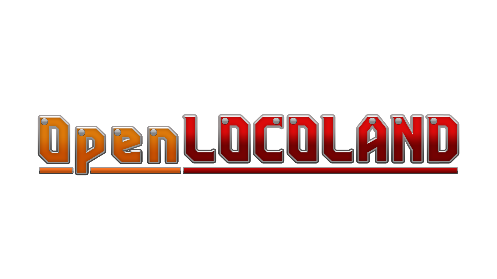

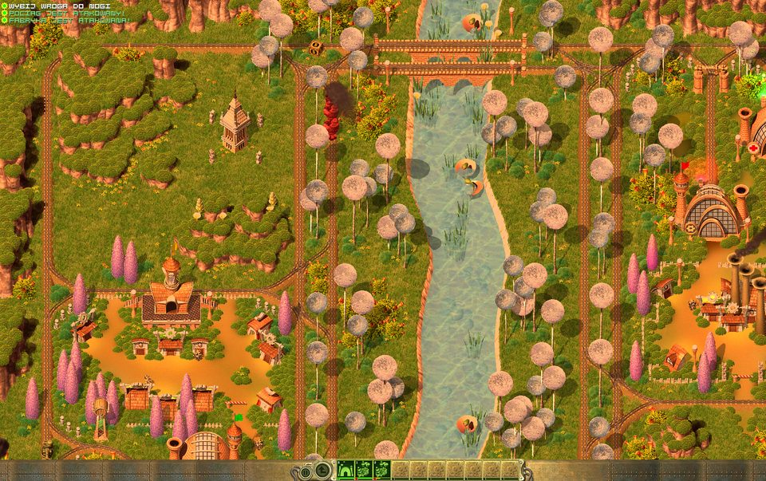

**Locoland** (Gromada, 2003) is a little-known strategy game about armed trains: you lay track,
send out locomotives with cannons and rocket launchers, and drive the invaders out of a land of
living trains. **OpenLocoland** brings it back to today's Windows: it runs in a window or on full
screen in any resolution, plays well on a wide screen, fixes some of the old crashes and bugs - and it has a **map editor inside the game** (work in progress), so you can make your own missions and share
them with friends.

It is a fan project, not affiliated with the makers of Locoland. It does not contain the game: you
need your own copy of [Locoland from Steam](https://store.steampowered.com/app/352130/Locoland/),
and OpenLocoland is put together from it on your computer. Your Steam game stays untouched.

## Trailer

The [trailer](https://www.youtube.com/watch?v=04BeRSnfL6o) and more videos of the project are on the
[OpenLocoland YouTube channel](https://www.youtube.com/@OpenLocoOffical).

## What you get

- **The game on today's Windows.** It runs in a window or on full screen in any resolution up to
  4K, shows more of the map on a wide screen and keeps a steady 60 frames a second.
- **Old bugs fixed.** Some of the original's crashes, missing sounds and a car the factory could
  never build are fixed; the ones still open are listed in [BUGS.md](BUGS.md).
- **Languages with their gaps filled.** English, German, Hungarian, Polish and Russian get their
  missing texts, and Czech is there too: a fan translation (unofficial) that works on any Steam
  language - with the files of the Czech CD edition at hand, that edition is used as its base. Setup's
  list shows every language, and for the ones still to be downloaded from Steam, how to get them.
  Volunteers can translate the game into their own language without git: they get a folder of texts
  to fill in (see [TRANSLATING.md](docs/TRANSLATING.md)).
- **Custom maps.** A second page of the strategic map holds **POLIGON**, a ready mission to try,
  and every map you make or get from a friend.
- **A map editor inside the game (work in progress).** Make your own missions - lay the track,
  shape the ground, put up buildings with their guns, give trains their orders, send in new trains
  during the mission, plan what the enemy's factory builds, decide who fights whom - and play them
  at once. The trains that come onto the map are set in a list of arrivals, and a factory's plan says
  which trains it builds and when; a train of any army can drive, patrol, attack, guard a point or
  watch an area from where it stands, and a car can be turned round in its place or uncoupled. The
  cars and the decorations are picked from a row above the bar, the gravel bed is painted under the
  rails, a quick test runs the map right in the editor without saving it, and a map can be renamed or
  deleted from the editor's menu. The help inside the editor has 29 pages. The custom maps page lists
  every map folder it finds, however the map got there.
- **Maps for friends.** A map goes to a friend as one file and turns up on their custom maps page.
- **An OpenLocoland logo at the start.** The game opens with the project's logo for a few seconds in
  place of the original intro movies; any key or a click skips it.
- **Updates.** The launcher tells you when there is a newer version and downloads it, and an update
  keeps your maps, scores and progress.
- **Two extras, off by default**: the developers' cheat keys and all missions open from the start
  (your real progress is not touched).

## Pictures

| | |
|---|---|
| 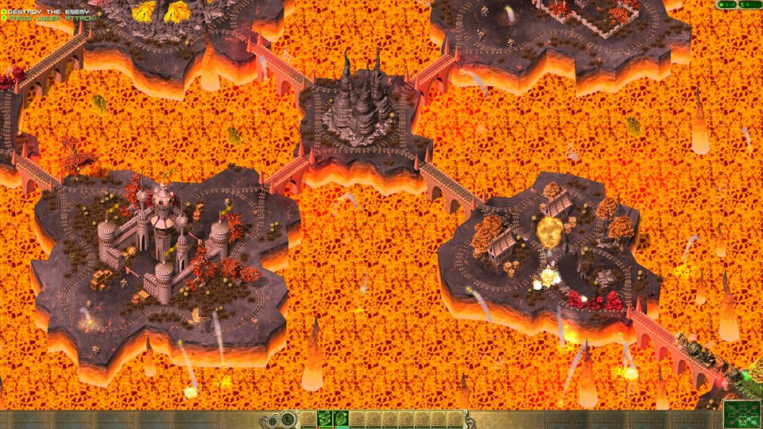 | 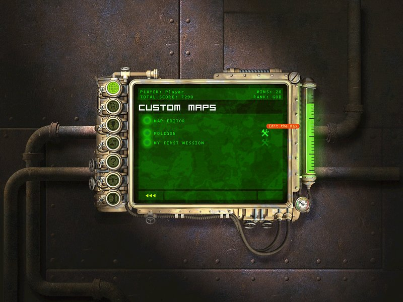 |
| A battle over the lava at 1920 x 1080 | Custom maps: POLIGON, your own maps and the editor |
| 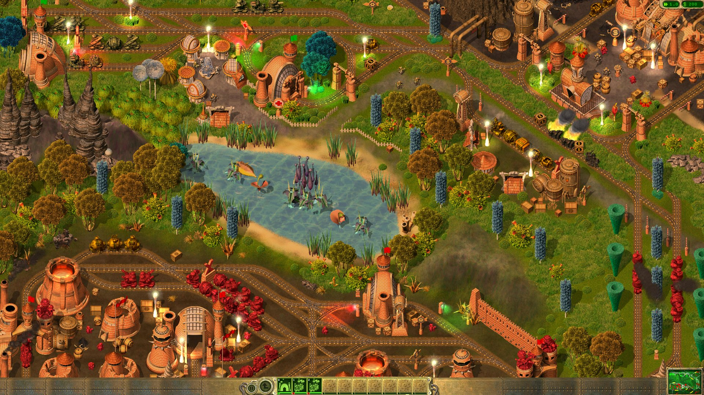 | 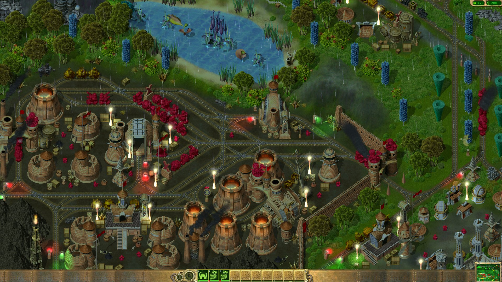 |
| The Factory - a map made in the editor (Dysprohol), at 1920 x 1080 | The Factory: the enemy's factory town in the south |
| 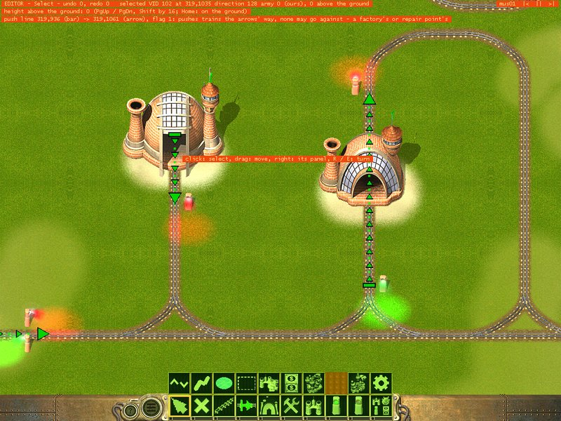 | 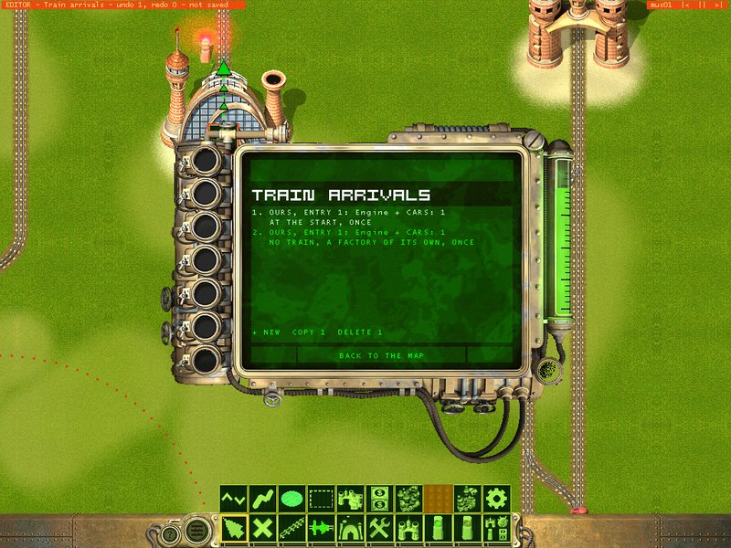 |
| The editor on POLIGON: the two factories | The trains that come during the mission |
| 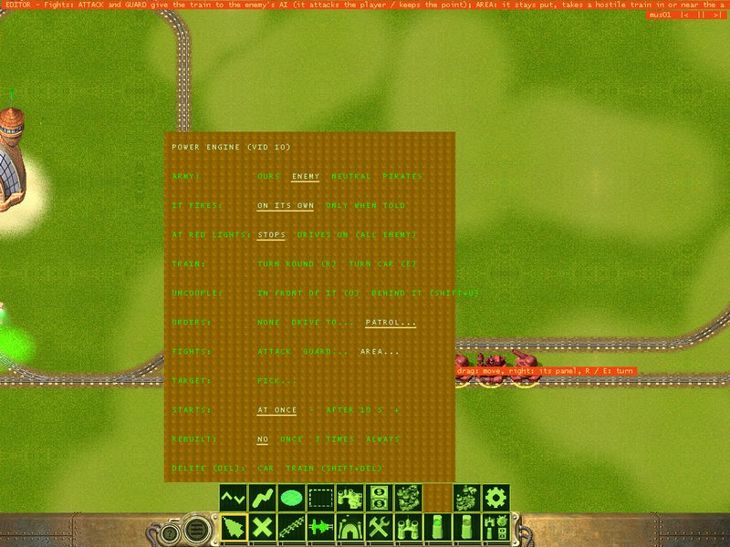 | 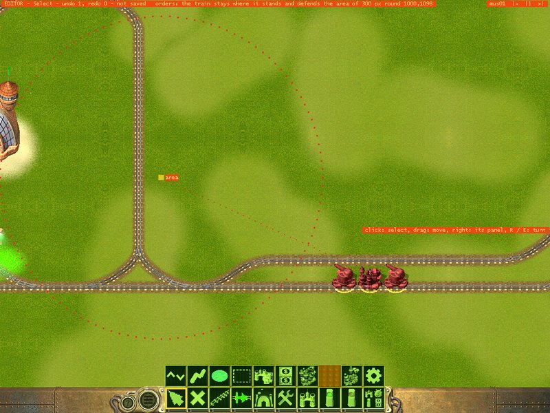 |
| A train's orders and fight rules | A train watching an area from where it stands |
| 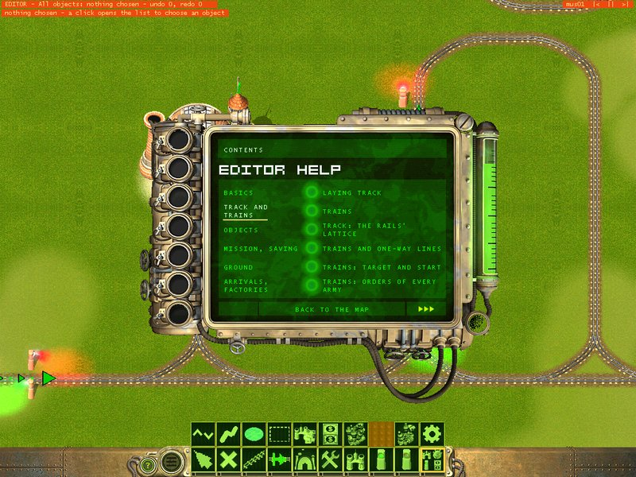 | 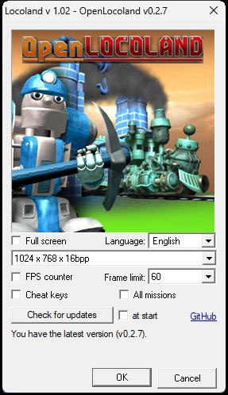 |
| Help inside the editor | The launcher, checking for updates |

## Installing

1. Install Locoland through Steam (any language).
2. Download `Setup.exe` from [Releases](https://github.com/Dysprohol/OpenLocoland/releases) and run
   it (Windows may warn about an unknown publisher: "More info" > "Run anyway"). It finds the
   Steam game and installs OpenLocoland into a folder of its own; you choose the language and the
   two extras there.
3. Start **Locoland** or **Locoland - map editor** from the desktop or the Start menu.

**Which copies of the game work:** the Steam version in every language it comes in (English,
German, Hungarian, Polish, Portuguese, Russian), and the CD editions built from the same program
(the Polish and the Czech ones). A CD edition with another program file - the Italian one, the
English beta/demo - can be installed "as it is" (a box in Setup): the game runs as the original with
its intros, without our fixes, the launcher's options or the editor. Support for those is planned.

Running a newer `Setup.exe` updates the game and keeps your maps, scores and progress; **Check for
updates** in the launcher finds a newer release and downloads its `Setup.exe` for you. The
player's guide tells the rest, the editor with a step-by-step first mission included:
[GUIDE.md](docs/GUIDE.md) (English), [PRZEWODNIK.md](docs/PRZEWODNIK.md) (Polish).

The map editor is still work in progress. Bugs and ideas are welcome in
[Issues](https://github.com/Dysprohol/OpenLocoland/issues).

## How it was made

Nobody has the source code of Locoland, so the work started with the program itself. The 2003
`Locoland.exe` was taken apart with the [Ghidra](https://ghidra-sre.org/) decompiler, and step by
step every one of the engine's 993 functions got a name and a description: how the trains drive,
how a map is stored, how the mission scripts run. The fixes are written in C++ in `LocoFix.dll`,
which the original program loads at start, so the game stays itself and keeps working at every
step. Graphics go through [dgVoodoo2](http://dege.freeweb.hu/dgVoodoo2/), which turns the old
DirectX 7 into something today's Windows draw properly.

Along the way the authors' own map editor turned up inside the engine - the mode they made the
campaign with, switched off in the game they sold. OpenLocoland switches it back on and builds the
rest around it: the bar, the tools and the help in the look of the game.

## Plans

- **Multiplayer.** The engine already lists network functions for its mission scripts, but the
  authors never wrote them. The goal is to play with or against a friend.
- **The other editions.** The fixes and the editor for the copies with another program file (the
  Italian CD, the English beta/demo), which now install as they are.
- **New missions.** Our own missions and an alternative campaign made in the editor, next to the
  original twenty.
- **More fixes and polish.** The bugs still open in [BUGS.md](BUGS.md), the interface scaled up on
  big screens, the editor tried in full screen, and whatever turns up while playing.
- **Releases after players' reports.** The next releases follow what players report and ask for in
  Issues.
- **The engine in readable code.** The understood parts of the engine rewritten in C++ one by one,
  so the game can grow past the limits of the original program.
- **Ideas for later**: a modding tool for new objects, music and sounds of our own.

## For developers

- [DEVELOPERS.md](DEVELOPERS.md) - building from the repository, the layout, everything known
  about the engine and its data, the fixes, the editor, the release.
- [BUGS.md](BUGS.md) - the bugs of the original game, fixed and open.
- [MAP_RULES.md](MAP_RULES.md) - what a map needs to work.

Nothing of the game is in this repository: game files are taken from the player's own Steam copy
when the game is put together, and our changes to them are kept as patches.

## Discord
https://discord.gg/NG5DnHFvYM

## Thanks

OpenLocoland is better thanks to the people who gave something of their own to it:

- **spacenerdy** (from Discord) - Discord creator 
- **Danetry** (from Discord) - support of the Czech fan translation of the game.
- **just_Martin** (from Discord) - the OpenLocoland logo (the installer's header and the launcher's
  picture).
- **[JohnVitoScaletta](https://steamcommunity.com/profiles/76561199078710882/)** (from Steam) - the
  Czech fan translation of the game.

## Credits

Locoland is by Gromada and ESDigital Games. dgVoodoo2 is by Dege (see [NOTICE.md](external/dgVoodoo2/NOTICE.md)).
OpenLocoland is a fan project, not affiliated with the rights holders of Locoland.
