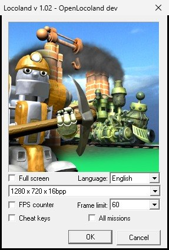
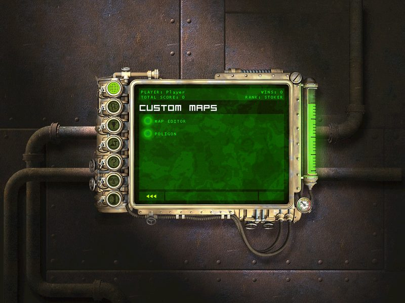
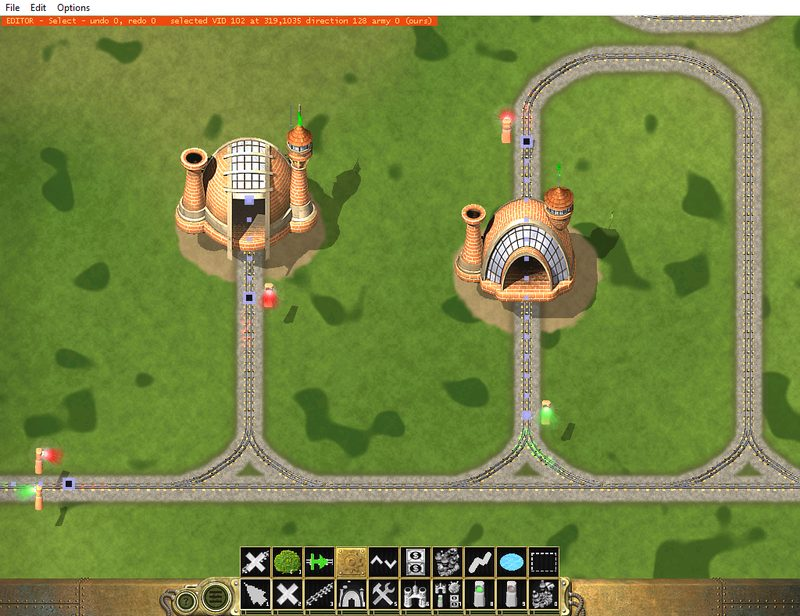
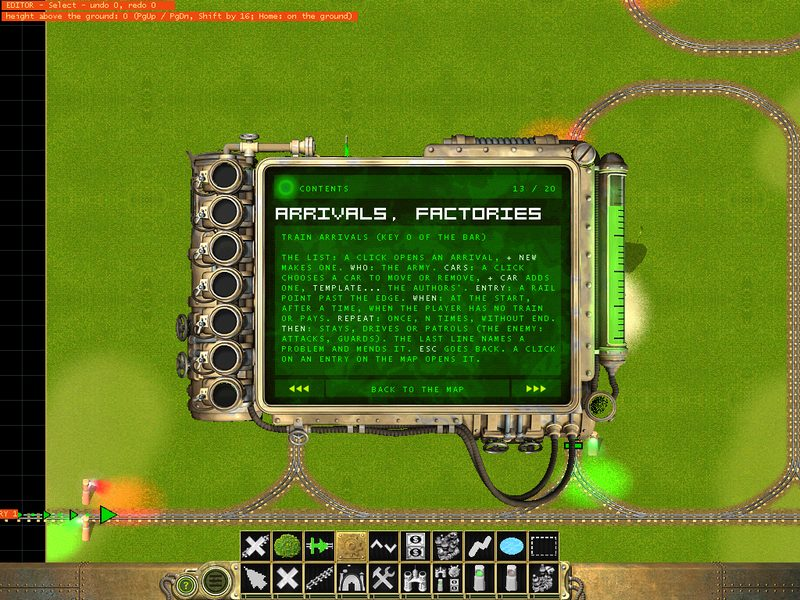
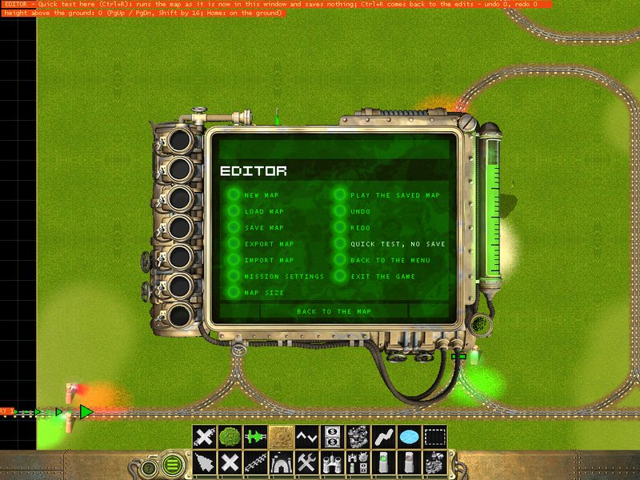
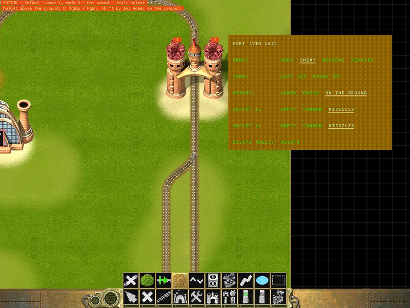
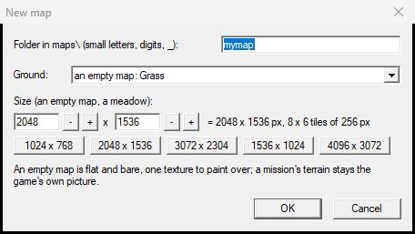
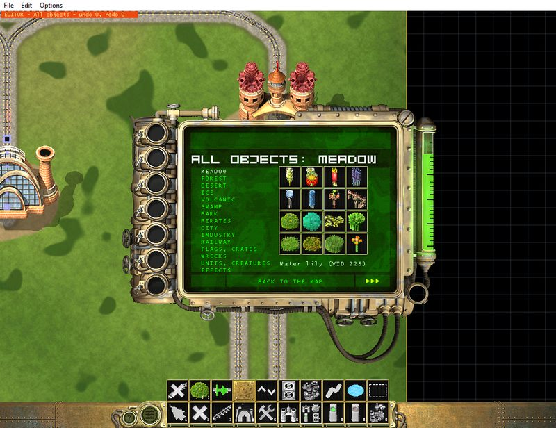

# OpenLocoland - player's guide

Version 0.1 - a test release. [Polish version: PRZEWODNIK.md](PRZEWODNIK.md)

**OpenLocoland** is an unofficial, fan-made new edition of **Locoland** (Gromada / ESDigital
Games, 2003): the original game runs with fixes for today's Windows, a few improvements, a page
of custom maps in the menu and a **map editor** inside the game. It is not affiliated with the
rights holders of Locoland.

It does **not** contain the game. It needs your own copy of **Locoland from Steam**: Setup takes
the game's files from it and puts OpenLocoland together in a folder of its own. Your Steam
installation is not changed - you can still start the original from Steam.

Contents:

1. [Installing, updating, uninstalling](#1-installing-updating-uninstalling)
2. [The first start](#2-the-first-start)
3. [What is new in the game](#3-what-is-new-in-the-game)
4. [Custom maps and POLIGON](#4-custom-maps-and-poligon)
5. [The map editor](#5-the-map-editor)
6. [Tutorial: your first mission](#6-tutorial-your-first-mission)
7. [Keys and tools of the editor](#7-keys-and-tools-of-the-editor)
8. [Questions and problems](#8-questions-and-problems)

## 1. Installing, updating, uninstalling

You need: Windows 10 or 11 and Locoland installed through Steam (any of its languages).

**Installing.** Run `Setup.exe`. It finds your Steam copy of Locoland and installs
OpenLocoland into `C:\Users\<you>\Games\OpenLocoland` (you can choose another folder). It makes these shortcuts:
- **Locoland** - the game,
- **Locoland - map editor** - the editor on an empty map,

on the desktop and in the Start menu (Setup can leave them out).

The game folder is self-contained: the maps you make, your high scores and the logs live there.
Your profile (the player's name, the missions won, the scores, the sound settings) is kept in your
Windows user's registry, as the original kept it.

**Updating.** Run a newer `Setup.exe` and press **Update**: it finds the installed game and copies only what changed. Your own maps (in `maps\` of the game folder) and your profile are kept.

**Uninstalling.** Run `Setup.exe` and press **Uninstall**: it removes the shortcuts and the game folder with everything in it (OpenLocoland is not listed in Windows "Apps"). The Steam game stays as it is. Copy your own maps somewhere first
if you want to keep them (each one is a folder in `maps\`, see [sharing a map](#13-save-export-and-share)).

## 2. The first start

The game starts with its launcher (the window with the Locoland picture):



- **Resolution** - besides 640 x 480 ... 1024 x 768 the list has the widescreen modes of your
  monitor (1280 x 720 up to 3840 x 2160) and your desktop's own resolution.
- **Full screen** - the box under the picture. Unticked, the game runs in a **window** (the window
  remembers its place).
- **Language** - the list next to it: the languages you have (Polish, English, ...). The launcher's
  labels change with it.
- **Limit FPS** and **FPS counter** - the row under the resolution: how many frames a second the game
  draws (60 by default; ∞ = no limit) and a small counter at the top of the screen.

Your choice is remembered. The intro movies are skipped: the game opens on the player's screen.
Make a player (or pick yours) and the strategic map with the campaign's 20 missions comes up.

## 3. What is new in the game

The missions play as they always did. What changed:

- **A window or full screen, any resolution.** The game area of the window is exactly the chosen
  resolution, the picture and the mouse are right in a window, and the window starts in the middle
  of your screen (it also never comes back off-screen after the game was closed while minimised).
- **Widescreen.** On a big screen you see more of the map; the interface goes to the edges. Mission 1
  (a 1024 x 768 map) and the menus are scaled up to fill the height of the window. The objects and
  the shadows are drawn across the whole screen.

  

- **The state bar across the whole screen.** On a wide screen the bar at the bottom runs from edge
  to edge instead of stopping in the middle.
- **A second row in the factory panel.** A factory can build up to 14 kinds of cars (keys F1 - F12,
  `[` and `]`), but its panel showed ten. The 11th and further now show in a second row above the
  first, and a click on them works.
- **The middle mouse button** drags the map, in the missions too.
- **A steady frame rate** (60 by default) instead of the game using a whole processor core.
- **Your progress carries over.** The profile you had in the original (missions won, scores,
  settings) is taken over the first time you start OpenLocoland.
- **Fixes** of crashes and mistakes of the original: a crash when the repair point took over an
  enemy car, crashes of some mission scripts, a car kind the factory could never build, the mouse
  stuck at the bottom of the screen on a second monitor left of or above the main one, sounds that
  were missing, the fort's cannon rising out of its pit in every direction, and more.
- **The translations** are completed (Polish and English): the missing tips and unit names. The
  explosive mine (**Mine**) and the mining plant (**Mining plant**) have names of their own.

## 4. Custom maps and POLIGON

The strategic map has a **second page**: the `►►►` button at its bottom right leads to
**CUSTOM MAPS**, `◄◄◄` back to the campaign.



- **MAP EDITOR** (the first row) starts the editor - see [the map editor](#5-the-map-editor).
- Under it are the custom maps: those that came with the game and those you make or get from
  friends. A long list scrolls - the arrows beside it, the mouse wheel, the up and down keys.
- A click on a map shows its briefing; **START GAME** plays it like a campaign mission.

**POLIGON** is a ready mission made with the same tools as the editor: the enemy has built a
bastion in the east - a fort with two guns guards its gates, behind it stand its factory and repair
point, and new trains come out of the factory. Break through and destroy them. (Its texts are in
Polish only.)

A custom map is not a campaign mission: winning it does not unlock missions or add to your
campaign score, rank or the hall of fame. It keeps its own high score table, "restart the mission"
in the Esc menu plays it again, and after it the menu comes back on the custom maps page.

## 5. The map editor

The editor is the engine's own editor mode, which the authors used for their maps and which the
game never offered: what you place is what the game plays. You can open any map in it - a new
one, POLIGON or a campaign mission (save a campaign map under a name of its own before changing it).

**Starting it:** **MAP EDITOR** on the custom maps page - the game starts again in the editor, on a
new empty map: 2048 x 1536 of grass in a folder of its own (`maps\map1\`, then `map2` ...), titled
MAP 1. The desktop shortcut **Locoland - map editor** opens one straight away. Save it to keep it
(Menu → **SAVE MAP**): a start map left unsaved is removed when you leave it (another map, back to the
menu, exit), so trying the editor out leaves nothing behind.



What you see:

- **The map** as authored, standing still: the level is *held* - nothing moves, no script runs.
  Outside the map there is a dim grid and the map's edge has a frame (you can scroll 300 px past
  the edge: the track goes on out there).
- **The bar** at the bottom in the look of the game's state bar: tools 1 - 0 in its slots, more
  tools in the **strip** above it. The chosen one is framed.
- **The status line** at the top: the tool (or the one under the mouse), the undo and redo counts,
  "not saved" and the last message - why something could not be done is always written there.
- **The ? and menu buttons** at the left end of the bar (where the game has its pause button).
  **?** (or F1) opens the help: eleven pages with everything of this chapter in short.

  

  The **menu button** opens the editor's menu with every command - new, load, save, mission
  settings, map size, play the map, undo, redo, run the level, back to the menu, exit.

  

**Moving around:** the screen edge, the arrow keys, or drag with the middle mouse button.

**The basic editing** (the Select tool, key 1):

| Action | How |
|---|---|
| select | click an object (the smallest under the cursor); the circle marks it |
| move | drag it |
| turn | R / E or the mouse wheel |
| raise / lower it | PgUp / PgDn by 4 (with Shift by 16), or Shift+wheel; Home puts it back on the ground - the status line shows its height above the ground |
| change its army | A: ours, enemy, neutral, pirates - the flags change colour |
| delete | Del (Shift+Del: a whole train; Shift+click with the Delete tool: a whole section of track) |
| undo / redo | Ctrl+Z / Ctrl+Y - every change, as many steps as you like |
| its panel | the right mouse button on it |

The **object's panel** (right button) has its army, turning, its height (lower, raise, on the ground) and delete, a semaphore's colour and
its line, and - for a fort, a mining plant or a citadel - the gun in each of its sockets (empty, a
cannon or missiles). The right button elsewhere closes it.



## 6. Tutorial: your first mission

We will make a small mission: the player's train arrives from past the west edge, the player has
a factory and a repair point; the enemy has a fort with two guns on the line and a train on patrol.
The mission is won when the enemy has no units left.

### 1. A new map

The editor starts on an empty 2048 x 1536 grass map - you can build the mission right on it and
save it under a name of your own (Menu → **SAVE MAP**, e.g. `maps\bridge_1\bridge_1.map`). For another
ground or size, Menu button → **NEW MAP**:



- **Folder** - the map's name: small letters, digits and `_` (e.g. `bridge_1`). The map is
  `maps\bridge_1\bridge_1.map`.
- **Ground** - *an empty map* of one texture (grass, sand, snow, rock ... - flat and bare, to paint
  on), *a meadow*, or the terrain of one of the campaign's maps.
- **Size** - for an empty map or a meadow: from 512 to 4096 px each way in steps of 256 (`-` and
  `+`), or a preset: 1024 x 768 (small, like mission 1), 2048 x 1536 (most missions), 3072 x 2304
  (big). Take 2048 x 1536 for a start.

OK - the editor opens the new map. It already has a mission script and texts made from the
template; you will fill them in at step 10. (**MAP SIZE** in the menu changes the size later.)

### 2. Paint the ground

The strip's **Paint the ground**: `[` and `]` pick a texture (grass, light grass, forest floor,
sand, desert, snow, ice, rock, dark rock, lava, swamp, lake bed - taken from the campaign's
maps), `+` and `-` the brush (8 - 200 px). Paint by dragging. Shift+drag puts the original picture
back. Paint a sand path where the track will run and some patches of other textures. The painted
picture is saved with the map.

### 3. Water, swamp, lava

The strip's **Water and lava**: `W` picks water, swamp or lava; drag to lay it. It lowers the
ground into a basin with a shore, lays the water's surface and adds its effects (circles on the
water, bubbles, lava eruptions) and a region where explosions splash. Shift+drag takes it away.
One kind of water has one level on a map, as in the missions.

The **Ground height** tool shapes the ground: hold the left button and drag (`M` picks raise,
lower, flatten or smooth, the mouse wheel or `+`/`-` the radius). The brush is soft - full in the middle, less toward
its edge - and goes on while you hold it still. The ground's picture follows: a hill shows as a
shaded hill and hides what stands behind it, in the editor and in the game (the picture is saved
with the map; on a campaign terrain it becomes the map's own). Contour lines every 4 levels show
the heights while the tool is chosen; `H` shows them with any tool. **Flatten** takes the level
where the stroke begins: begin it on the track to make a plateau at the track's level. Objects
stay on the ground; the tool leaves the track and the ground beside it alone.

An object can stand higher or lower on its own: select it and press `PgUp` / `PgDn` (or Shift+wheel,
or HEIGHT in its panel); `Home` puts it back on the ground. Train cars and rails stay on the track.
A few units and guns are always put on the ground by the game itself; the status line says so.

### 4. The main line

**Track** (key 3). Click to start a line - at the end of a rail of the map or anywhere - and every
next click lays **one rail** toward the cursor; the right button ends the line. The preview shows
the next rail: **green** ends - it fits, **red** - the status line says which rule it breaks:

- one step is 71 x 50 px or its half (the rails' lattice);
- a turn goes through a **curve** and turns at most 45° (a straight rail does not join a diagonal
  directly);
- at most 6 rails meet at a point;
- a **junction**: start a new line at a point of an existing line - a branch is a straight rail and
  a curve with the same middle, a **Y junction** like in the missions.

Lay the main line the way the missions do: from **past the west edge** (scroll out over the grid)
along the map, so the trains come and go out of sight. Then a spur for the factory: a branch off
the line through a Y, a straight piece ending in a **dead end**.

`V` switches the kind of the next rails: plain, swamp (on its embankment), destroyed or destroyed
swamp. `PgUp` / `PgDn` make the next rail climb or descend (a ramp onto higher ground: each ramp
11 levels). For a line on a hill, lay it up its ramps first, then raise the ground around the top and
flatten it starting on the track. `B` picks the gravel bed under new rails. Del or the **Delete a section of track** tool removes rails.

### 5. The reinforcement point

**Reinforcement point** (key 0): click on the main line **past the west edge**. Here the player's
train arrives at the start of the mission (and further waves later, see step 10). It stands on
the nearest track by itself.

### 6. The factory, the repair point, one-way lines and semaphores

**Factory** (key 4) and **Repair point** (key 5) go where the authors put them - the preview
shows where, and placing them elsewhere is refused with the reason:

- a **factory** at the **dead end of a spur**, turned the way out. It comes with its **exit line**:
  a one-way line along the spur (built cars appear in the factory and are pushed out) and a red
  semaphore at it;
- a **repair point** on a **straight piece** of track, turned along it like a gate. It comes with a
  one-way line through it (trains are pushed through and every car is repaired) and its semaphores.

Dragging one of them moves it, with its line, to the nearest right place; deleting it deletes the
line too.

**One-way lines** (the strip's **Push line**): a line on the track no train may enter against its
direction, as the missions mark the entry onto the map, the exit, the factories and the repair
points. Click its beginning and its end on the track; then, on a selected line, `T` switches
pushing on or off, `R` turns it round, `S` puts its semaphores, Del deletes it. Make two:

- the **map's entry**: from the main line's end past the edge onto the map, pushing on;
- the **map's exit** at the other end, short and pointing into the map, pushing off - so no train
  drives off the map.

**Semaphores** (keys 8 green, 9 red) are signs only - they show the way of the one-way lines and
stand beside the track; `T` switches the colour. On a selected semaphore `L` makes a line at it that
lets in the trains it faces (green), `Shift+L` one that keeps them out (red).

### 7. The enemy

- **Fort** (key 6, the enemy's): put it **on the track** of the main line - it is a gate the trains
  drive through. It comes armed: its panel (right button) sets the gun in each socket - a cannon or
  missiles. The fort itself cannot be destroyed; its guns can.
- **All objects** (key 7) opens the palette with every object the missions use, by theme (meadow,
  forest, desert, ice, volcanic, swamp, park, pirates, city, industry, railway, flags and crates,
  wrecks, units and creatures, effects): click one, then place it. Here are the **mining plant**
  (two gun sockets, like the fort), the citadel, walls, buildings, robots.

  

- **Trains**: the strip's **Vehicles** opens the cars - locomotives, combat cars, supply cars
  (ammunition, repair car, tankers), civil cars, obstacles. A car goes on the track under the
  cursor; placed at a train's end it is coupled to it. Make the enemy's train: a locomotive and a
  gun car, then `A` on it for the enemy's army. `U` uncouples a car, `C` couples to another train,
  `R` turns the train round, a drag moves it along the track. A train needs a **locomotive** to
  move.
- **A patrol**: the train's panel → PATROL → to a point..., then click the far end on the track.
  The train drives there and back.
- More enemy trains can be set in the mission settings (step 10): trains at the start and trains
  the enemy's factory sends later. For those the enemy needs a factory: put one (key 4) at a dead
  end of its own and `A` to the enemy.
- A **money crate** (strip) lies on the track: a unit of the player that takes it gets 100.

Remember the rule of the game: the factory, the repair point and the fort stand **on the track or
right next to it**.

### 8. Decorate

The strip's **Decals**: grass, bushes, flowers, stones, wrecks... `[` `]` (or a click on the
entry) picks one; a click puts one, a drag scatters them in the radius (wheel, `+` `-`), never nearer than
the spacing (`<` `>`). Shift+drag takes them away. Trees, houses and the rest are in **All objects**.
A **Region** (strip): drag its rectangle; its panel sets fog (mist, dust, haze, glow) and splashes.

### 9. Look at it working

Menu → **RUN THE LEVEL** (or `Ctrl+R`): the level comes to life in the editor - the trains drive,
the guns shoot. `Ctrl+R` holds it again. (A level that has run is not as you placed it: load it
again before saving if you changed things while it ran.)

### 10. Mission settings and texts

Menu → **MISSION SETTINGS** (or the gear in the strip):

- **Title** on the custom maps page and the **briefing's header**;
- **Money** at the start, the **time of day** (day, evening, night, morning), **rain**,
  **lightning**;
- **Enemy attackers at once** - how many enemy trains attack together;
- **Player's reinforcement waves** and **their train** (the car kinds by number, e.g. `5,20` - an
  engine and a gun car; the numbers are in the Vehicles palette next to the names). The first wave brings the player's
  train at the start; the next comes when the player's train is gone and the factory still stands;
- **Enemy trains at the start**, one a line: `type x y` (it fights from there) or `type x1 y1 x2 y2`
  (it patrols between two points of the track). The types are `light_`, `medium_`, `hard_`,
  `very_hard_`, `diff_` or `defence_` with `gun`, `mortair`, `rocket`, `air`, `fire` or `desant`, e.g.
  `light_gun`. The points are screen points: the **Push line** tool shows the track's point under the
  cursor in the status line;
- **Enemy trains from its factory**: `seconds type` (or with a patrol `seconds type x1 y1 x2 y2`) -
  the earliest time it is built;
- **Objectives**, the **win** and **loss** texts and the **briefing** (a line `---` starts the next
  page). They are written in capitals, 44 characters a line, when the map is saved.

The mission is **won** when the enemy had units and has none left (its trains, its factory, the
fort's guns), and **lost** when the player has no units left and no factory.

### 11. Play it

Menu → **PLAY THE MAP**: the game starts again with your map as a mission - the briefing in the Esc
menu, the reinforcement arriving, the enemy attacking. When it ends, the game comes back to the
editor on your map; to go back at once, press Esc, the exit button (ABORT GAME) and **BACK TO THE
EDITOR**. Unsaved changes are asked about first.

### 12. Save

Menu → **SAVE MAP** (Alt+F2). A map saved as `maps\<name>\<name>.map` - a new map is
already there - is written with its script and texts and appears on the **custom maps** page under
its title. Open it again with **LOAD MAP** (Alt+F3).

### 13. Save, export and share

**Export:** Menu -> **EXPORT MAP** packs the current map - the map, its painted ground, its script, texts and briefing - into one `.zip` file; the save dialog starts on the Desktop. Save your edits first (the editor offers it). Campaign maps and the empty template cannot be exported.

**Import:** Menu -> **IMPORT MAP** takes such a `.zip` (also one packed again by Windows) and puts the map on the **CUSTOM MAPS** page. When you already have a map of that name, the editor asks: **Yes** overwrites yours, **No** keeps both (the new one comes as `<name>_2`), **Cancel** stops. Then it offers to open the map in the editor.

A map is its folder: `maps\<name>\` in the game folder holds the map (`<name>.map`), its painted
ground (`<name>.vid`), its script (`<name>.lgc`) and its texts. To give it to a friend by hand:
send the whole folder; they put it into `maps\` of their game folder and add two lines at the end of
`maps\custom.lst` (Notepad): the folder's name and the title in capitals, e.g.

```
bridge_1
BRIDGE OF NO RETURN
```

## 7. Keys and tools of the editor

**The bar** (slots 1 - 0):

| Key | Tool | |
|---|---|---|
| 1 | Select | select, drag, turn, army, panel |
| 2 | Delete | a click deletes; Shift+click on a rail: its section |
| 3 | Track | lays rails (V kind, PgUp/PgDn ramp, B bed) |
| 4 | Factory | at a dead end, with its exit line |
| 5 | Repair point | on a straight piece, with its line |
| 6 | Fort | on the track, armed |
| 7 | All objects | the palette |
| 8 / 9 | Semaphore green / red | beside the track |
| 0 | Reinforcement point | the player's train arrives here |

**The strip** (above the bar, left to right): Delete a section of track, Decals, Push line,
Mission settings, Ground height, Money crate, Vehicles, Paint the ground, Water and lava, Region.

**Keys:**

| Key | |
|---|---|
| R / E, wheel | turn (a train: turn round) |
| A | next army |
| T | semaphore red / green; on a line: pushing on / off |
| L / Shift+L | a line at the selected semaphore: lets in / keeps out |
| Del / Shift+Del | delete / a whole train or section |
| Ctrl+Z / Ctrl+Y | undo / redo |
| U / C | uncouple / couple a car |
| `[` `]` | the decal, the texture |
| `<` `>` | the decals' spacing |
| wheel, `+` `-` | the brush's size (Ground height, Decals, Paint, Water) |
| M | the ground brush: raise, lower, flatten, smooth |
| H | the ground's heights (contour lines) with any tool |
| B | the gravel bed of new track |
| V | the kind of new rails |
| PgUp / PgDn | the selected object up / down by 4 (Shift: 16); Track tool: the next rail climbs / descends |
| Home | the selected object back on the ground |
| W | water, swamp or lava |
| S | the selected line's semaphores (Push line tool) |
| Shift (with a brush) | take away |
| Esc, right button | back to Select; ends a line of track |
| Ctrl+R | run / hold the level |
| F1 | help |
| Alt+F2 / Alt+F3 | save / load |

## 8. Questions and problems

- **The game does not start, or Setup does not find Locoland.** Locoland must be installed through
  Steam (any language).
- **Where are my maps?** In `maps\` of the game folder (C:\Users\<you>\Games\OpenLocoland), one folder each; the
  list of the custom maps page is `maps\custom.lst`.
- **Something went wrong.** The game writes `error.log` and `LocoFix.log` into its folder; send them
  with a description of what happened.
- **Full screen.** It works, but windowed mode is the tested one; if the screen stays black, untick
  "full screen" in the launcher.

---

OpenLocoland is an unofficial project; Locoland belongs to its rights holders (Gromada, ESDigital
Games, Alawar). It uses dgVoodoo2 by Dege for the graphics on current Windows.
