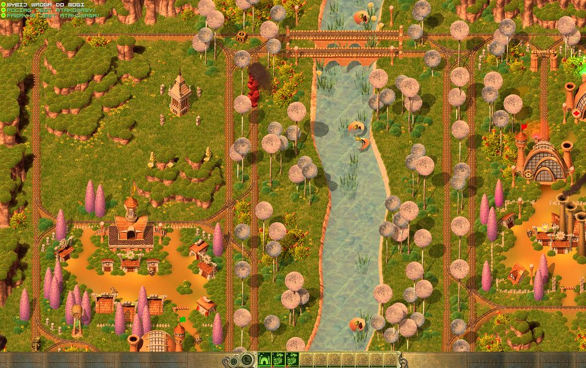
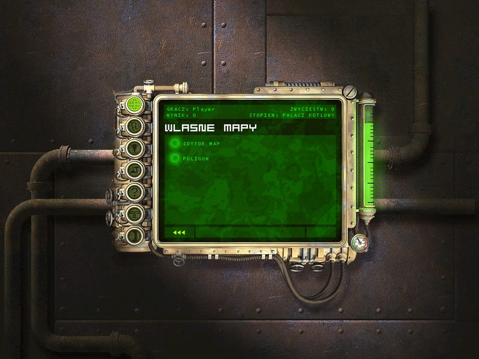
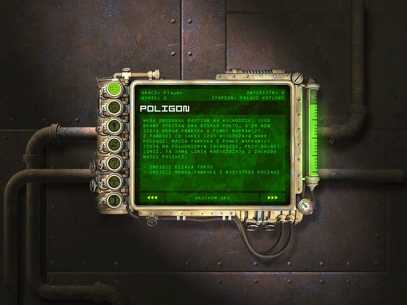
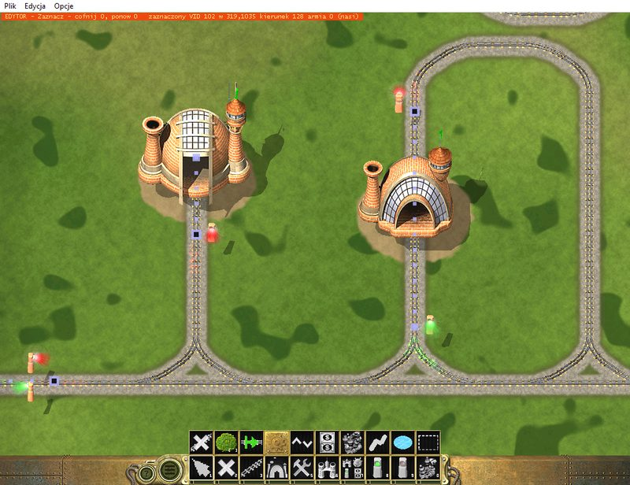
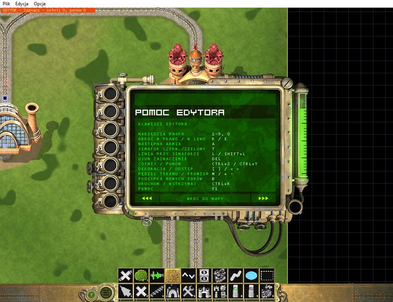
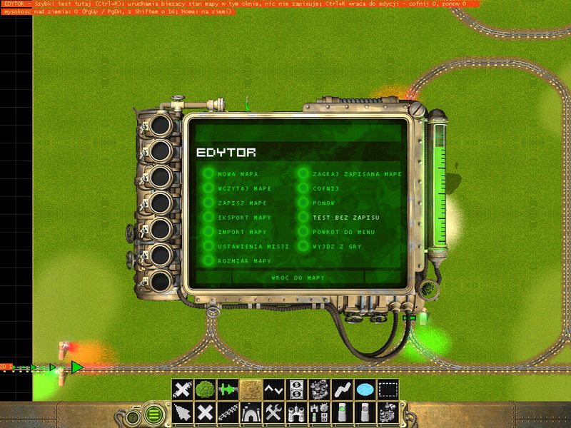
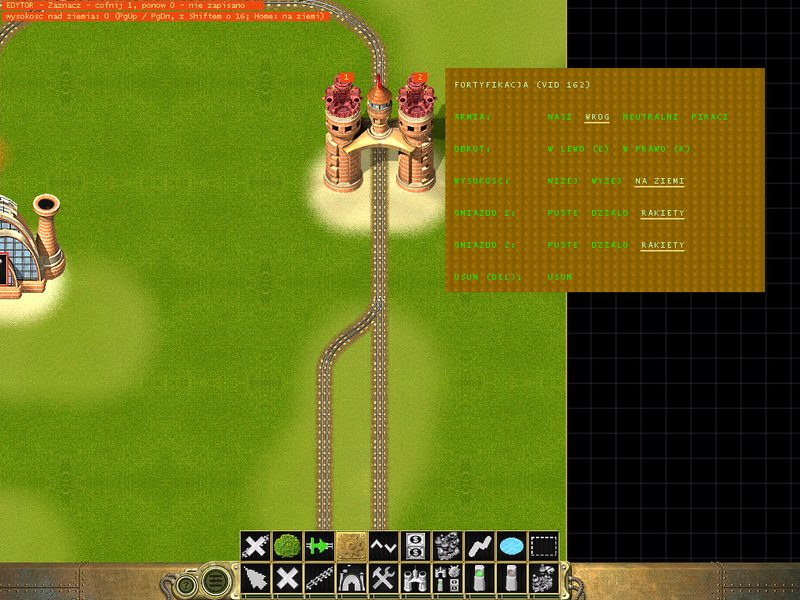
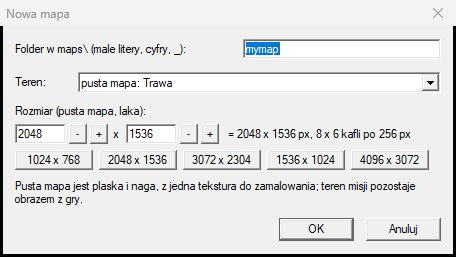
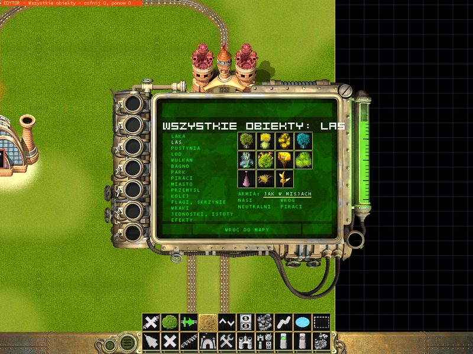

# OpenLocoland - przewodnik gracza

Wersja 0.1 - wydanie testowe. [English version: GUIDE.md](GUIDE.md)

**OpenLocoland** to nieoficjalna, fanowska nowa edycja gry **Locoland** (Gromada / ESDigital
Games, 2003): oryginalna gra działa z poprawkami dla dzisiejszego Windowsa, kilkoma ulepszeniami,
stroną własnych map w menu i **edytorem map** wbudowanym w grę. Projekt nie jest związany z
właścicielami praw do Locolandu.

Paczka **nie zawiera** gry. Potrzebny jest twój własny **Locoland ze Steama**: instalator bierze
z niego pliki gry i składa OpenLocoland w osobnym folderze. Instalacja Steama się nie zmienia -
oryginał nadal uruchomisz ze Steama.

Spis treści:

1. [Instalacja, aktualizacja, odinstalowanie](#1-instalacja-aktualizacja-odinstalowanie)
2. [Pierwsze uruchomienie](#2-pierwsze-uruchomienie)
3. [Co nowego w grze](#3-co-nowego-w-grze)
4. [Własne mapy i POLIGON](#4-własne-mapy-i-poligon)
5. [Edytor map](#5-edytor-map)
6. [Samouczek: twoja pierwsza misja](#6-samouczek-twoja-pierwsza-misja)
7. [Klawisze i narzędzia edytora](#7-klawisze-i-narzędzia-edytora)
8. [Pytania i problemy](#8-pytania-i-problemy)

## 1. Instalacja, aktualizacja, odinstalowanie

Potrzebne są: Windows 10 lub 11 i Locoland zainstalowany przez Steam (w dowolnym języku).

**Instalacja.** Uruchom `Setup.exe`. Instalator znajdzie twojego Locolanda ze Steama i
zainstaluje OpenLocoland w `C:\Users\<ty>\Games\OpenLocoland` (można wybrać inny folder). Tworzy skróty:
- **Locoland** - gra,
- **Locoland - edytor map** - edytor na pustej mapie,

na pulpicie i w menu Start (instalator może ich nie tworzyć).

**Język gry.** Lista w instalatorze pokazuje wszystkie języki gry. Wybrać można języki twojej kopii
ze Steama oraz fanowskie tłumaczenia oznaczone **(nieoficjalne)** (czeski), które instalator
zbuduje na dowolnym języku, jaki masz. Pozostałe są wyszarzone, a obok jest wiersz, który pobiera
je ze Steama (np. `download_depot 352130 352132` dla niemieckiego): wpisz go w konsoli Steama
(`steam://open/console` w pasku adresu przeglądarki albo w Win+R), poczekaj, aż Steam go pobierze,
i uruchom instalator ponownie - zostawi wybrany język i doda nowy.

Folder gry jest samodzielny: są w nim twoje mapy, tabele wyników i logi. Profil gracza (imię,
wygrane misje, wyniki, ustawienia dźwięku) jest zapisany w rejestrze twojego użytkownika Windows,
tak jak w oryginale.

**Aktualizacja.** Uruchom nowszy `Setup.exe` i wciśnij **Aktualizuj**: znajdzie zainstalowaną grę i skopiuje tylko to, co się zmieniło. Twoje mapy (w `maps\` folderu gry) i twój profil zostają.

Czy jest nowsza wersja, sprawdzisz przyciskiem **Sprawdź aktualizacje** w okienku startowym (zob.
[pierwsze uruchomienie](#2-pierwsze-uruchomienie)). Okienko pyta stronę projektu na GitHubie i
odpowiada „Masz aktualną wersję” albo „Jest nowa wersja ...”; wtedy **Pobierz** zapisuje nowy
`Setup.exe` w folderze Pobrane, a **Uruchom Setup** uruchamia go (po pytaniu) i zamyka grę, żeby
instalator mógł ją zaktualizować - Windows może zapytać, czy uruchomić pobrany program, jak po
pobraniu przeglądarką. Link **GitHub** otwiera zamiast tego stronę wydań w przeglądarce (prawy
przycisk myszy kopiuje adres). Zaznacz **przy starcie**, żeby sprawdzać przy każdym otwarciu
okienka; domyślnie jest wyłączone i nic nie jest pobierane ani instalowane bez twojego kliknięcia.
Gdy GitHub jest nieosiągalny (brak internetu albo projekt się przeniósł), okienko mówi o tym i
podaje adres projektu z pliku `update.txt` w folderze gry - późniejszy Setup może ten plik zmienić,
ty też.

**Odinstalowanie.** Uruchom `Setup.exe` i wciśnij **Odinstaluj**: usuwa skróty i folder gry ze wszystkim, co w nim jest (OpenLocoland nie figuruje w „Aplikacjach” Windows). Gra ze Steama zostaje bez zmian. Jeśli chcesz zachować swoje
mapy, skopiuj je najpierw (każda to folder w `maps\`, zob. [udostępnianie mapy](#13-zapis-eksport-i-udostępnianie)).

## 2. Pierwsze uruchomienie

Gra startuje okienkiem startowym (z obrazkiem Locolandu):

- **Rozdzielczość** - oprócz 640 x 480 ... 1024 x 768 lista ma tryby panoramiczne twojego monitora
  (od 1280 x 720 do 3840 x 2160) i rozdzielczość pulpitu.
- **Pełny ekran** - pole pod obrazkiem. Gdy nie jest zaznaczone, gra działa w **oknie** (okno
  pamięta swoje miejsce).
- **Język** - lista obok: języki, które masz (polski, angielski, ...; fanowskie tłumaczenie jest
  oznaczone „(nieoficjalne)”). Napisy okienka zmieniają się razem z nim. Jeśli wybranego języka już
  nie ma, gra startuje po angielsku, a bez angielskiego w języku twojej kopii ze Steama.
- **Limit FPS** i **Licznik FPS** - wiersz pod rozdzielczością: ile klatek na sekundę rysuje gra
  (domyślnie 60; ∞ = bez limitu) i mały licznik u góry ekranu.
- **Sprawdź aktualizacje** - wiersz nad OK: czy jest nowsza wersja OpenLocoland, zob.
  [aktualizacja](#1-instalacja-aktualizacja-odinstalowanie).

Wybór jest zapamiętany. Filmy na początku są pomijane: gra otwiera się na ekranie gracza. Utwórz
gracza (albo wybierz swojego) - pojawi się mapa strategiczna z 20 misjami kampanii.

## 3. Co nowego w grze

Misje grają się tak jak zawsze. Co się zmieniło:

- **Okno albo pełny ekran, dowolna rozdzielczość.** Obszar gry w oknie ma dokładnie wybraną
  rozdzielczość, obraz i mysz zgadzają się w oknie, a okno startuje na środku ekranu (i nie wraca
  już poza ekran, gdy grę zamknięto zminimalizowaną).
- **Ekrany panoramiczne.** Na dużym ekranie widać więcej mapy, a interfejs jest przy krawędziach.
  Misja 1 (mapa 1024 x 768) i menu są powiększane do wysokości okna. Obiekty i cienie są rysowane na
  całym ekranie.

  

- **Pasek stanu na całą szerokość.** Na szerokim ekranie pasek na dole biegnie od krawędzi do
  krawędzi zamiast kończyć się na środku.
- **Drugi rząd w panelu fabryki.** Fabryka może budować do 14 rodzajów wagonów (klawisze F1 - F12,
  `[` i `]`), ale jej panel pokazywał dziesięć. Jedenasty i dalsze są teraz w drugim rzędzie nad
  pierwszym i można je klikać.
- **Środkowy przycisk myszy** przeciąga mapę, także w misjach.
- **Stała liczba klatek** (domyślnie 60) zamiast zajmowania przez grę całego rdzenia procesora.
- **Postępy przechodzą z oryginału.** Profil z oryginału (wygrane misje, wyniki, ustawienia) jest
  przejmowany przy pierwszym uruchomieniu OpenLocoland.
- **Poprawki** awarii i błędów oryginału: awaria, gdy punkt naprawczy przejmował wagon wroga,
  awarie niektórych skryptów misji, rodzaj wagonu, którego fabryka nigdy nie mogła zbudować, mysz
  utykająca na dole ekranu na drugim monitorze po lewej lub nad głównym, brakujące dźwięki, działo
  fortyfikacji wysuwające się z dołu w każdym kierunku i inne.
- **Tłumaczenia** są uzupełnione (polskie i angielskie): brakujące podpowiedzi i nazwy jednostek.
  Mina (ładunek wybuchowy, **Mina**) i kopalnia (budynek, **Kopalnia**) mają wreszcie osobne nazwy.

## 4. Własne mapy i POLIGON

Mapa strategiczna ma **drugą stronę**: przycisk `►►►` w jej prawym dolnym rogu prowadzi do
**WLASNE MAPY**, `◄◄◄` z powrotem do kampanii.



- **EDYTOR MAP** (pierwszy wiersz) uruchamia edytor - zob. [edytor map](#5-edytor-map).
- Pod nim są własne mapy: te dołączone do gry i te, które zrobisz albo dostaniesz od znajomych.
  Długa lista się przewija - strzałki obok niej, kółko myszy, klawisze w górę i w dół.
- Kliknięcie mapy pokazuje jej odprawę; **URUCHOM GRE** gra ją jak misję kampanii.
- Młotek i klucz na prawo od tytułu mapy (**Edytuj mape**) otwierają tę mapę w edytorze.



**POLIGON** to gotowa misja zrobiona tymi samymi narzędziami co w edytorze: wróg zbudował bastion
na wschodzie - bramy strzegą dwa działa fortyfikacji, za nią stoi jego fabryka i punkt naprawczy, a
z fabryki co jakiś czas wyjeżdżają nowe pociągi. Przebij się i zniszcz je.

Własna mapa nie jest misją kampanii: jej wygranie nie odblokowuje misji, nie dodaje do wyniku
kampanii, stopnia ani galerii chwały. Ma własną tabelę wyników, „ponów misję” w menu Esc gra ją od
nowa, a po niej menu wraca na stronę własnych map.

## 5. Edytor map

Edytor to własny tryb edycji silnika, w którym autorzy robili swoje mapy i którego gra nigdy nie
udostępniła: co postawisz, to gra zagra. Otworzysz w nim każdą mapę - nową, POLIGON albo misję
kampanii (mapę kampanii zapisz pod własną nazwą, zanim zaczniesz ją zmieniać; POLIGON i szablon
też - każda aktualizacja gry zapisuje je od nowa, więc edytor zawsze zapisuje je pod nową nazwą,
proponując np. `poligon1`).

**Uruchamianie:** **EDYTOR MAP** na stronie własnych map - gra uruchamia się od nowa w edytorze, na
nowej pustej mapie: 2048 x 1536, trawa, jeszcze bez nazwy (NOWA MAPA). Skrót na pulpicie **Locoland -
edytor map** od razu otwiera taką mapę. `Ctrl+S` (albo Menu → **ZAPISZ MAPE**) ją zapisuje: za
pierwszym razem pyta o nazwę - wpisz np. `most_1`, a mapa trafi do własnego folderu
`maps\most_1\most_1.map` i na stronę własnych map. Nigdy niezapisana nowa mapa znika, gdy ją opuścisz
(inna mapa, powrót do menu, wyjście), więc wypróbowanie edytora niczego nie zostawia.



Co widać:

- **Mapę** tak, jak ją zrobiono, w bezruchu: poziom jest *wstrzymany* - nic się nie rusza, żaden
  skrypt nie działa. Poza mapą jest przyciemniona siatka, a krawędź mapy ma ramkę (można przewinąć
  300 px poza krawędź: tory biegną tam dalej).
- **Pasek** na dole w wyglądzie paska stanu gry: narzędzia 1 - 0 w jego gniazdach, kolejne na
  **listwie** nad nim. Wybrane jest w ramce.
- **Wiersz stanu** u góry: narzędzie (albo to pod myszą), liczba kroków do cofnięcia i ponowienia,
  „nie zapisano” i ostatni komunikat - dlaczego czegoś nie da się zrobić, zawsze jest napisane tutaj.
- **Przyciski ? i menu** na lewym końcu paska (tam, gdzie gra ma przycisk pauzy). **?** (albo F1)
  otwiera pomoc: osiemnaście stron z tym, co jest w tym rozdziale, w skrócie. Zaczyna się od **spisu
  treści**: kategorie (PODSTAWY, TORY I POCIĄGI, OBIEKTY, MISJA I ZAPIS, TEREN, PRZYJAZDY I FABRYKI)
  po lewej, strony tej pod myszą po prawej - kliknięcie otwiera stronę. Strona ma swoją kategorię za
  tytuł i swój numer (5 / 17); strzałki, Page Up / Down i kółko zmieniają strony, a **SPIS TRESCI**,
  `Esc` albo prawy przycisk wracają do spisu. **Przycisk menu**
  otwiera menu edytora ze wszystkimi poleceniami - nowa mapa, wczytaj, zapisz, ustawienia misji,
  rozmiar mapy, zagraj zapisaną mapę, cofnij, ponów, test bez zapisu, powrót do menu, wyjdź z gry.

  

  

**Poruszanie się:** krawędź ekranu, klawisze strzałek albo przeciąganie środkowym przyciskiem myszy.

**Podstawy edycji** (narzędzie Zaznacz, klawisz 1):

| Czynność | Jak |
|---|---|
| zaznaczenie | kliknij obiekt (najmniejszy pod kursorem); oznacza go kółko |
| przesunięcie | przeciągnij go |
| obrót | R / E albo kółko myszy |
| wyżej / niżej | PgUp / PgDn o 4 (z Shift o 16) albo Shift+kółko; Home stawia z powrotem na ziemi - wiersz stanu pokazuje wysokość nad ziemią |
| zmiana armii | A: nasi, wróg, neutralni, piraci - flagi zmieniają kolor |
| usunięcie | Del (Shift+Del: cały pociąg; Shift+klik narzędziem Usun: cały odcinek toru) |
| cofnij / ponów | Ctrl+Z / Ctrl+Y - każdą zmianę; pamięta ostatnie 500 kroków |
| panel obiektu | prawy przycisk myszy na nim |

**Panel obiektu** (prawy przycisk) ma jego armię, obrót, wysokość (niżej, wyżej, na ziemi) i usuwanie, kolor semafora i linię przy
nim, a dla fortyfikacji, kopalni i cytadeli - działo w każdym gnieździe (puste, działo albo
rakiety; gdy panel jest otwarty, gniazda są ponumerowane na murze, a kliknięcie działa otwiera panel
jego budowli). Prawy przycisk gdzie indziej albo Esc go zamyka.



## 6. Samouczek: twoja pierwsza misja

Zrobimy małą misję: pociąg gracza przyjeżdża zza zachodniej krawędzi, gracz ma fabrykę i punkt
naprawczy, wróg ma na linii fortyfikację z dwoma działami i patrolujący pociąg. Misja jest wygrana,
gdy wrogowi nie zostanie żadna jednostka.

### 1. Nowa mapa

Edytor startuje na pustej mapie 2048 x 1536 z trawą - możesz zrobić misję od razu na niej i zapisać
ją pod własną nazwą (`Ctrl+S` za pierwszym razem o nią pyta, np. `most_1`). Dla innego terenu albo
rozmiaru: przycisk menu → **NOWA MAPA**:



- **Folder** - nazwa mapy: małe litery, cyfry i `_` (np. `most_1`). Mapa to `maps\most_1\most_1.map`.
- **Teren** - *pusta mapa* z jednej tekstury (trawa, piasek, śnieg, skała ... - płaska i goła, do
  malowania), *łąka* albo teren jednej z map kampanii.
- **Rozmiar** - dla pustej mapy albo łąki: od 512 do 4096 px w każdą stronę co 256 (`-` i `+`) albo
  gotowy: 1024 x 768 (mała, jak misja 1), 2048 x 1536 (większość misji), 3072 x 2304 (duża). Na
  początek weź 2048 x 1536.

OK - edytor otwiera nową mapę. Ma już skrypt misji i teksty zrobione z szablonu; uzupełnisz je w
kroku 10. (**ROZMIAR MAPY** w menu zmienia rozmiar później: mniejsza mapa traci teren i obiekty za
nową krawędzią - tor może biec jeszcze 300 px dalej, poza zasięgiem wzroku.)

### 2. Pomaluj teren

**Malowanie terenu** z listwy: jego rząd przycisków nad paskiem ma tekstury (trawa, jasna trawa,
ściółka, piasek, pustynia, śnieg, lód, skała, ciemna skała, lawa, bagno, dno jeziora - wzięte z map
kampanii; `[` i `]` też je wybierają), **ROZMIAR** (8 - 200 px; także kółko myszy), **SILA** (ile
pokrywa jedno pociągnięcie: mniejsza pozwala mieszać tekstury) i **KRAWEDZ** miękką albo twardą. Maluj
przeciągając lewym przyciskiem; prawy (albo Shift+przeciąganie) przywraca oryginalny obraz; Alt+klik
pobiera teksturę spod kursora (także z obrazu pomalowanego i zapisanego wcześniej). Namaluj
piaszczystą drogę tam, gdzie pobiegną tory, i kilka plam innych tekstur. Pomalowany obraz zapisuje
się razem z mapą.

### 3. Woda, bagno, lawa

**Woda i lawa** z listwy: `W` wybiera wodę, bagno albo lawę; przeciągaj, żeby ją położyć. Obniża teren
w nieckę z brzegiem, kładzie powierzchnię wody i dodaje jej efekty (kręgi na wodzie, bąble, wybuchy
lawy) oraz region, w którym wybuchy rozpryskują wodę. Shift+przeciąganie ją usuwa. Jeden rodzaj
wody ma na mapie jeden poziom, tak jak w misjach.

Narzędzie **Wysokosc terenu** kształtuje teren swoim rzędem przycisków nad paskiem: tryb -
**PODNIES/OBNIZ** (lewy przycisk podnosi, prawy obniża), **WYROWNAJ**, **WYGLADZ**, **RAMPA** (przeciągnij
z jednego punktu do drugiego: równy spadek między ich poziomami, np. podjazd na płaskowyż) i
**NIEROWNOSCI** (lekkie losowe nierówności); **ROZMIAR** (także kółko myszy), **SILA** (jak szybko działa) i
**KRAWEDZ** miękka albo twarda (twarda: urwiska i płaskowyże). Shift wyrównuje, a Ctrl wygładza na
jeden ruch bez zmiany trybu; `M` przełącza tryby. Pędzel działa dalej, gdy trzymasz go w miejscu, a
poziom pod kursorem zawsze widać w wierszu stanu. Obraz terenu idzie za
wysokościami: wzgórze widać jako wzgórze z cieniem i zasłania to, co stoi za nim, w edytorze i w grze
(obraz zapisuje się z mapą; na terenie misji kampanii staje się własnym obrazem mapy). Poziomice co
4 poziomy pokazują wysokości, gdy narzędzie jest wybrane; `H` pokazuje je przy każdym narzędziu.
**Wyrównywanie** bierze poziom miejsca, w którym zaczynasz - zacznij na torze, żeby zrobić płaskowyż
na wysokości toru - albo poziom pobrany przez Alt+klik. Obiekty zostają na ziemi; torów i terenu tuż przy nich narzędzie nie rusza.

Obiekt może też stać wyżej albo niżej sam: zaznacz go i naciśnij `PgUp` / `PgDn` (albo Shift+kółko,
albo WYSOKOSC w jego panelu); `Home` stawia go z powrotem na ziemi. Wagony i szyny zostają na torach.
Kilka jednostek i dział gra zawsze sama stawia na ziemi; wiersz stanu to mówi.

### 4. Główna linia

**Tory** (klawisz 3). Kliknij, żeby zacząć linię - na końcu szyny mapy albo gdziekolwiek - a każde
następne kliknięcie kładzie **jedną szynę** w stronę kursora; prawy przycisk (albo Esc) kończy linię,
a kliknięcie kółkiem myszy usuwa szynę pod kursorem (Ctrl+Z ją przywraca). Podgląd
pokazuje następną szynę: **zielone** końce - pasuje, **czerwone** - wiersz stanu mówi, którą
zasadę łamie:

- krok to 71 x 50 px albo jego połowa (siatka torów);
- skręt zawsze przez **łuk**, najwyżej o 45° (prosta szyna nie łączy się wprost ze skośną);
- w jednym punkcie spotyka się najwyżej 6 szyn;
- **rozjazd**: zacznij nową linię w punkcie istniejącej - odgałęzienie to prosta szyna i łuk o tym
  samym środku, **rozjazd Y** jak w misjach.

Główną linię połóż tak, jak robią to misje: **zza zachodniej krawędzi** (przewiń nad siatkę) przez
mapę, żeby pociągi przyjeżdżały i odjeżdżały poza widokiem. Potem bocznica na fabrykę: odgałęzienie
od linii przez Y, prosty odcinek kończący się **ślepym końcem**.

`V` zmienia rodzaj następnych szyn: zwykłe, bagienne (na nasypie), zniszczone albo zniszczone
bagienne. `PgUp` / `PgDn` sprawiają, że następna szyna wznosi się albo opada (rampa na wyższy
teren: każda rampa to 11 poziomów). Linię na wzgórze najpierw wprowadź po rampach, potem podnieś teren
wokół jej końca i wyrównaj go, zaczynając na torze. `B` wybiera podsypkę pod nowe szyny. Del albo narzędzie **Usun odcinek toru** usuwa szyny.

**Podsypka.** Gdy tory leżą, **Malowanie terenu** → **PODSYPKA** kładzie podsypkę pod szynami, po
których przejdzie pędzel: **RODZAJ** (łąka, lód, wulkan, pustynia - ten sam, który `B` kładzie pod
nowe szyny), **SZEROKOSC** (28 px, jak w misjach), **ROZMIAR**, **SILA**, **KRAWEDZ**. Na mapie z
własnym terenem pas jest wmalowany w obraz, na środku szyn, wzdłuż łuków, rozjazdów i ramp, a
naklejki podsypki tych szyn znikają (pas jest teraz ich podsypką); na terenie mapy kampanii kładzie
zamiast tego naklejki podsypki. Prawy przycisk przywraca oryginalny obraz, Alt+klik pobiera rodzaj,
**POD CALA MAPA** kładzie podsypkę pod każdą szyną mapy naraz. Jedno pociągnięcie to jedno cofnięcie.

### 5. Przyjazdy pociągów

**Przyjazdy pociagow** (klawisz 0) otwiera panel z pociągami, które w czasie misji wjeżdżają na mapę -
pociąg gracza na start, posiłki, fale wroga. Najpierw jest ich lista, każdy przyjazd w dwóch wierszach
zwykłych słów („1. NASI, WJAZD 1: LOKOMOTYWA + WAGONY: 2”, „NA POCZATKU, RAZ”); kliknięcie otwiera
przyjazd, **+ NOWY** tworzy nowy, **KOPIUJ n** i **USUN n** dotyczą ostatnio otwartego. W przyjeździe
każdy wiersz to jedna rzecz:

- **KTO** - nasi, wróg, neutralni albo piraci;
- **SKLAD** - w kolejności pociągu: **+ WAGON** dodaje na koniec z palety Pojazdy, **SZABLON...**
  pokazuje listę składów autorów z nazwami; kliknięcie wagonu go wybiera - **<** i **>** go przesuwają,
  **USUN** go zabiera. Lokomotywa może stać w dowolnym miejscu składu;
- **WJAZD** - **WSKAZ**, potem kliknij główną linię **za zachodnią krawędzią**: tam powstaje
  pociąg;
- **KIEDY** - **NA POCZATKU**, **PO** czasie, **GDY GRACZ NIE MA POCIAGU** albo **GDY GRACZ ZAPLACI**
  kwotę (te dwa **NIE WCZESNIEJ NIZ** po czasie);
- **POWTORZ** - **RAZ**, ileś **RAZY** albo **BEZ KONCA**, **CO** tyle sekund;
- **POTEM** - pociąg naszych, neutralnych i piratów **STOI**, **JEDZIE DO PUNKTU** albo **PATROLUJE**
  między dwoma punktami; wroga **ATAKUJE**, **PILNUJE PUNKTU** albo **PATROLUJE** (robi to AI gry).
  Punkty **WSKAZ** na torze, poza główną linią;
- **KOMUNIKAT** („przybyły posiłki”, dla naszych i wroga).

Pasek nad tytułem podaje prawdziwy problem z przyciskiem, który go naprawia - brak wjazdu (**WSKAZ
WJAZD**), brak świateł na wjeździe (**POSTAW SWIATLA**: para semaforów w pierwszym miejscu w mapie i ich
linia, która wpycha pociąg - linia wjazdu i jej światła to jedno, jak w misjach) albo światła na drodze
bez linii do nich (**LINIA DO SWIATEL**), brak lokomotywy w składzie, brak punktu. Fala czeka, gdy na wjeździe stoi pociąg. Strzałka na dole po lewej, Esc albo prawy przycisk
wracają do listy; kliknięcie wjazdu albo punktu na mapie otwiera jego przyjazd. Każdą zmianę cofa
Ctrl+Z. Mapy ze starszej wersji zachowują swoje posiłki i pociągi startowe wroga ze skryptu (widać je
jako znaczniki na torze; kliknięcie znacznika otwiera ten panel), dopóki w panelu nie wybierzesz
**PRZESTAW NA PRZYJAZDY**: pociągi startowe stają wtedy na mapie jako zwykłe pociągi z rozkazami
(patrol albo atak), które edytuje się jak każdy pociąg.

### 6. Fabryka, punkt naprawczy, linie jednokierunkowe i semafory

**Fabryka** (klawisz 4) i **Punkt naprawczy** (klawisz 5) stają tam, gdzie stawiali je autorzy -
podgląd pokazuje gdzie, a postawienie gdzie indziej jest odrzucane z podaniem powodu:

- **fabryka** na **ślepym końcu bocznicy**, obrócona wyjazdem na zewnątrz. Dostaje swoją **linię
  wyjazdu**: linię jednokierunkową wzdłuż bocznicy (zbudowane wagony pojawiają się w fabryce i są
  wypychane) i czerwony semafor przy niej;
- **punkt naprawczy** na **prostym odcinku** toru, obrócony wzdłuż niego jak brama. Dostaje linię
  jednokierunkową przez siebie (pociągi są przez niego przepychane, a każdy wagon naprawiany) i
  swoje semafory. `R` albo `E` (albo **OBROT: ZAWROC** w jego panelu) obraca go na torze:
  linia biegnie wtedy w drugą stronę, a semafory zamieniają się miejscami.

Przeciągnięcie przenosi je razem z linią na najbliższe właściwe miejsce; usunięcie usuwa też linię.
**Bloker** (kozioł oporowy, w grupie KOLEJ we Wszystkich obiektach) staje na najbliższym końcu toru,
w poprzek niego, tak jak w misjach.

**Linie jednokierunkowe** (**Linia jednokierunkowa** z listwy): linia na torze, na którą żaden
pociąg nie wjedzie pod prąd - tak misje oznaczają wjazd na mapę, wyjazd, fabryki i punkty naprawcze.
Kliknij jej początek i koniec na torze - na mapie linia ma kreskę na początku i strzałki w stronę,
w którą biegnie, a mysz nad nią mówi, co robi; potem na zaznaczonej linii - wiersz stanu podaje jej początek, koniec i to, co robi; także narzędziem
Zaznacz kliknięcie kreski lub strzałki linii ją zaznacza, a prawy przycisk otwiera jej panel - `T` włącza albo wyłącza
pchanie, `R` ją odwraca, `S` stawia jej semafory, Del ją usuwa. Zrób dwie:

- **wjazd na mapę**: od końca głównej linii za krawędzią na mapę, z pchaniem;
- **wyjazd z mapy** na drugim końcu, krótki i skierowany w głąb mapy, bez pchania - żeby żaden
  pociąg nie wyjechał poza mapę.

**Semafory** (klawisze 8 zielony, 9 czerwony) są tylko znakami - pokazują kierunek linii
jednokierunkowych i stoją obok toru, po prawej stronie pociągów, na które patrzą, jak w misjach:
staje po tej stronie toru, którą wskażesz (`R` / `E` albo kółko: po drugiej), a na postawionym `R` / `E`
obracają go - przechodzi na drugą stronę toru, do pociągów jadących w drugą stronę; wiersz stanu i jego
panel (DLA POCIAGOW) mówią, dla których jest. `T` zmienia kolor. Postawiony semafor od razu dostaje własną linię
jednokierunkową, tak jak mają je semafory misji, a podgląd ją pokazuje: wjazd przez **zielony** semafor jest rysowany na zielono, zatrzymanie przy **czerwonym** - krótkim czerwonym znakiem przed nim, kończącym się przy nim:
**zielony** wpuszcza pociągi, na które patrzy (linia biegnie od nich i przepycha je obok niego),
**czerwony** zatrzymuje je przy sobie (linia biegnie zza niego, a pod prąd nie wolno). Zielony i
czerwony naprzeciw siebie po dwóch stronach toru dzielą jedną linię - to wjazd na mapę, jeśli postawisz
je tam, gdzie wchodzi główna linia. Obrót, `T` albo przesunięcie zmieniają linię, usunięcie semafora
ją usuwa (chyba że ma ją jeszcze drugi z pary). Semafor postawiony przy końcu innej linii należy do niej i własnej nie dostaje;
`L` (zielony) i `Shift+L` (czerwony) i tak dają zaznaczonemu semaforowi własną linię, a wiersz LINIA
jego panelu ją zabiera (BRAK).

**Co buduje fabryka**: prawy przycisk na fabryce, **CO BUDUJE...**. Dla twojej fabryki (i neutralnej,
której lista będzie twoja po jej zdobyciu) kliknij jednostki, które może budować - zachowują kolejność i
klawisze gry F1-F12, [ i ]; dla ostatnio klikniętej **NA LISCIE** ustawia, od kiedy (od początku albo po
czasie), a **NAJWYZEJ** - ile ich gracz może mieć.

**Co fabryka buduje ze skryptu - jej plan**: fabryka wroga pokazuje pociągi, które buduje jego AI (AI ma
tylko wróg), a druga zakładka **BUDOWANE POCIAGI** twojej, neutralnej albo pirackiej - pociągi, które
skrypt mapy każe jej zbudować. Ich lista i ekran każdego, jak w panelu przyjazdów: **POCIAG** (jego
wagony po kolei - lokomotywa gdziekolwiek -, **+ WAGON**, **SZABLON...** pociągi autorów), **KIEDY**
(**O CZASIE**, **PO INNYM** - tyle po zrobieniu pociągu przed nim na liście - albo **GDY** zachodzi
warunek, np. gracz ma mniej pociągów niż n, nie przed czasem), **POWTORZ** (raz, n razy albo bez końca,
co tyle po ostatnim) i **POTEM** (wroga atakuje, pilnuje punktu albo patroluje; pozostałych stoi, jedzie
do punktu albo patroluje). Pociąg twój, neutralnych albo piratów powstaje wagon po wagonie, gdy fabryka
jest wolna, a jego strona ma pieniądze na następny wagon (cena pod każdym), niezależnie od listy fabryki;
wróg buduje po jednym, gdy atakuje mniej jego pociągów, niż pozwala **AI...**. **AI...** ma pozostałe
ustawienia wroga od autorów, każde z linijką opisu: czy stracony pociąg startowy jest budowany na nowo i
po jakim czasie, wypady pociągów startowych, od kiedy są wypady i ile trwają, mądry atak. Wszystko poza
pociągiem raz o czasie wymaga mapy z przyjazdami (starsze mapy: PRZESTAW w panelu przyjazdów).

**Rozkazy pociągu**: prawy przycisk na pociągu, **ROZKAZY**: twoje, neutralne i pirackie **JEDZ DO...**
punktu albo **PATROL...** między miejscem, gdzie stoją, a punktem; wroga (z wagonem z działem - jego AI z
samej lokomotywy robi taran) **ATAK**, **PILNUJ...** punktu albo **PATROL...**. Punkt to kliknięcie na torze.
ROZKAZY są tylko w mapie z przyjazdami; mapa ze starszej wersji ma sam **PATROL**, dopóki w panelu
Przyjazdy nie wybierzesz **PRZESTAW NA PRZYJAZDY**.

**Zdobywanie**: neutralna fabryka albo punkt naprawczy staje się twój, gdy podjedzie do niego twój pociąg
(fort albo kopalnia - gdy nie ma już ich dział).

**Neutralni i piraci**: neutralni (armia 2) nigdy nie strzelają pierwsi. Gdy ktoś trafi neutralne działo,
fort albo pociąg, ono i neutralni, którzy to widzą, odpowiadają tylko tej stronie - do końca misji, a
ona może wtedy strzelać do nich. W panelu uzbrojonego neutralnego obiektu **STRZELA: W ODPOWIEDZI**
(tak jest od początku) albo **NIGDY**. Piraci (armia 3) walczą ze wszystkimi stronami, a wszyscy z nimi
(**W WALCE: PRZECIW WSZYSTKIM**). Tak gra mapa edytora; misje kampanii mają dawne zasady gry.

### 7. Wróg

- **Fortyfikacja** (klawisz 6, wroga): staje **na torze**, obrócona wzdłuż niego - to brama, przez
  którą przejeżdżają pociągi (`R` albo `E` obraca ją tam). Jest od razu uzbrojona: jej panel (prawy przycisk) ustawia działo w każdym
  gnieździe - działo albo rakiety. Samej fortyfikacji nie da się zniszczyć; jej działa tak.
- **Wszystkie obiekty** (klawisz 7) otwiera paletę ze wszystkimi obiektami z misji, według tematów
  (łąka, las, pustynia, lód, wulkan, bagno, park, piraci, miasto, przemysł, kolej, flagi i skrzynie,
  wraki, jednostki i stworzenia, efekty): kliknij jeden, potem postaw go na mapie. Wiersz **ARMIA**
  pod ikonami ustala, czyj będzie - JAK W MISJACH, NASI, WROG, NEUTRALNI albo PIRACI (paleta Pojazdy
  zaczyna od naszych); `A` przy stawianiu robi to samo. Są tu **kopalnia** (jedno gniazdo na
  działo), cytadela, mury, budynki, roboty. **Wrak** (spalony wóz
  albo wagon) postawiony albo przeciągnięty przy szynie staje na torze, wzdłuż niego (`R` go
  odwraca), tak jak w misjach; gdzie indziej zostaje tam, gdzie go postawisz. W grze pociąg najeżdża
  na niego i go miażdży - wrak pociągu nie zatrzymuje.

  

- **Cytadela** (piraci): staje nad **ukośnym torem**, razem z wieżą, kratami bramy i świdrami, jako
  jeden obiekt. W grze,
  dopóki stoi jej wieża, brama zatrzymuje i rani wszystko z innej armii niż wieża, co podjedzie
  blisko (poza neutralnymi); bez wieży jest niegroźna.
- **Charybda** (bagno): staje **na torze** - tor biegnie przez jej paszczę -, z okiem, zębami i
  działami, jako jeden obiekt. Wciąga pociągi innych armii, które ją mijają, a twoje zjada; jej działa
  śpią, dopóki jej nie zranisz. Zabij jej
  oko, żeby ją zniszczyć.
- **Gniazdo much** (jednostki i stworzenia): jego panel wybiera **ZIELONE, FALAMI** (fale zielonych
  much) albo **SZARE, NA STRAZY** (szare muchy, gdy twoje pociągi podjadą blisko, rój, gdy je
  zniszczysz).
- **Mina** (jednostki i stworzenia): staje na torze, w armii z wiersza palety. Edytor oznacza każdą
  minę jej armią (MINA: WROG); w grze widzi ją tylko jej armia - pociąg innej armii ją odpala, jej
  własne pociągi zatrzymują się przed nią.

- **Pociągi**: **Pojazdy** z listwy otwierają wagony - lokomotywy, wagony bojowe, zaopatrzenie
  (wóz z amunicją, pojazd naprawczy, cysterny), wagony cywilne, przeszkody. Wagon staje na torze
  pod kursorem; postawiony na końcu pociągu dołącza się do niego. Zrób pociąg wroga: lokomotywa i
  działo, potem `A` na nim dla armii wroga. `U` odczepia wagon, `C` doczepia do innego pociągu, `R`
  odwraca pociąg, przeciąganie przesuwa go po torze. Pociąg bez **lokomotywy** nie pojedzie.
- **Patrol**: panel pociągu → PATROL → do punktu..., potem kliknij drugi koniec na torze. Pociąg
  jeździ tam i z powrotem.
- Więcej pociągów wroga ustawisz w ustawieniach misji (krok 10): pociągi na początku i pociągi,
  które jego fabryka wysyła później. Do tych drugich wróg potrzebuje fabryki: postaw ją (klawisz 4)
  na własnym ślepym końcu i `A` na wroga.
- **Skrzynka z pieniedzmi** (listwa) leży na torze: jednostka gracza, która ją zbierze, dostaje 100.

Pamiętaj o zasadzie gry: fabryka, punkt naprawczy i fortyfikacja stoją **na torze albo tuż przy
nim**.

### 8. Ozdoby

**Dekoracje** z listwy: trawa, krzaki, kwiaty, kamienie, wraki... `[` `]` (albo kliknięcie pozycji)
wybiera jedną; kliknięcie stawia jedną, przeciąganie rozrzuca je w promieniu (kółko, `+` `-`), nigdy
bliżej niż odstęp (`<` `>`). Shift+przeciąganie je zbiera. Drzewa, domy i reszta są we **Wszystkie
obiekty**. **Region** (listwa): przeciągnij jego prostokąt; jego panel ustawia mgłę (mgła, pył,
opar, poświata) i rozpryski.

### 9. Zobacz, jak działa

Menu → **TEST BEZ ZAPISU** (albo `Ctrl+R`; szybki test tutaj): mapa działa w edytorze taka, jaka jest teraz, zapisana czy
nie, tak jak w grze - pociągi jeżdżą, działa strzelają, przyjeżdżają pociągi z panelu Przyjazdy. Nic
nie pyta: twoja mapa zapisuje się najpierw, a POLIGON, szablon, mapa kampanii i nowa mapa bez nazwy
działają z ukrytej kopii, więc zostają, jakie były. `Ctrl+R` wraca do edytora z mapą taką, jak przed
uruchomieniem - niezapisane zmiany dalej niezapisane, `Ctrl+Z` cofa je jak przedtem -, tak samo menu gry
pod `Esc` (WYJDŹ Z GRY → WRÓĆ DO EDYTORA albo TAK) i koniec poziomu (wygrana albo przegrana).

### 10. Ustawienia misji i teksty

Menu → **USTAWIENIA MISJI** (albo zębatka na listwie):

- **Tytuł** na stronie własnych map i **nagłówek odprawy**;
- **pieniądze na początku**; **pora dnia na początku** (dzień, wieczór, noc, ranek - potem płynie dalej,
  po 5 minut);
- **pogoda** - deszcz, śnieg, chmury, chmury burzowe albo meteoryty - i **jak często**: nigdy, od czasu
  do czasu (przychodzi i odchodzi, mniej więcej co pół minuty) albo cały czas;
- **błyskawice** - błyska przy czystym niebie; z deszczem tylko, gdy pada; przy śniegu, chmurach i
  meteorytach nie ma ich;
- **atakujących naraz** - ile pociągów wroga atakuje jednocześnie;
- **przyjazdy pociągów** - ich liczba i przycisk do ich panelu (krok 5); mapa ze starszej wersji ma tu
  **fale posiłków gracza** i **ich pociąg** (numery, np. `5,20`), dopóki nie zostanie przestawiona;
- **pociągi wroga na początku**, jeden w linii: `typ x y` (walczy stamtąd) albo `typ x1 y1 x2 y2`
  (patroluje między dwoma punktami toru). Typy to `light_`, `medium_`, `hard_`, `very_hard_`, `diff_`
  albo `defence_` z `gun`, `mortair`, `rocket`, `air`, `fire` albo `desant`, np. `light_gun`. Punkty są
  punktami ekranu: narzędzie **Linia jednokierunkowa** pokazuje w wierszu stanu punkt toru pod
  kursorem;
- **plan fabryki wroga**: ile ma pociągów; **Plan...** otwiera panel fabryki wroga, gdzie się je
  ustawia;
- **zadania**, teksty **zwycięstwa** i **porażki** oraz **odprawa** (linia `---` zaczyna następną
  stronę). Przy zapisie mapy są zapisywane wielkimi literami, po 44 znaki w linii.

Misja jest **wygrana**, gdy wróg miał jednostki i nie zostało mu żadnej (pociągi, fabryka, działa
fortyfikacji), a **przegrana**, gdy graczowi nie zostało żadnej jednostki ani fabryki.

### 11. Zagraj

Menu → **ZAGRAJ ZAPISANA MAPE**: gra uruchamia się od nowa z twoją zapisaną mapą jako misją - odprawa w menu Esc,
przybywające posiłki, atakujący wróg. Gdy się skończy, gra wraca do edytora na twoją mapę; żeby
wrócić od razu, naciśnij Esc, przycisk wyjścia (WYJDZ Z GRY) i **WROC DO EDYTORA**. O niezapisane
zmiany najpierw pyta.

### 12. Zapisz

`Ctrl+S` zapisuje mapę do jej pliku; mapa, która go jeszcze nie ma (mapa kampanii, nowa mapa), pyta
o nazwę - tak samo POLIGON i szablon, które aktualizacja by nadpisała (okno proponuje `poligon1`,
`map1` ..., a jego tytuł mówi dlaczego). Menu → **ZAPISZ MAPE** (Alt+F2) pyta zawsze - żeby zapisać pod inną nazwą. Mapa zapisana jako
`maps\<nazwa>\<nazwa>.map` zapisuje się ze skryptem i tekstami i pojawia na stronie **WLASNE MAPY**
pod swoim tytułem. Otworzysz ją znowu przez **WCZYTAJ MAPE** (Alt+F3). Każdy zapis pokazuje na chwilę
duże **ZAPISANO** z plikiem mapy na środku widoku, z kliknięciem menu.

### 13. Zapis, eksport i udostępnianie

**Eksport:** Menu → **EKSPORT MAPY** pakuje bieżącą mapę - mapę, jej pomalowany teren, skrypt, teksty i odprawę - do jednego pliku `.zip`; okno zapisu otwiera się na Pulpicie. Najpierw zapisz zmiany (edytor to proponuje). Map kampanii i pustego szablonu nie da się eksportować.

**Import:** Menu → **IMPORT MAPY** bierze taki `.zip` (także spakowany ponownie przez Windows) i dodaje mapę na stronę **WLASNE MAPY**. Gdy masz już mapę o tej nazwie, edytor pyta: **Tak** nadpisuje twoją, **Nie** zostawia obie (nowa dostaje nazwę `<nazwa>_2`), **Anuluj** przerywa. Potem proponuje otworzyć mapę w edytorze.

Mapa to jej folder: `maps\<nazwa>\` w folderze gry zawiera mapę (`<nazwa>.map`), jej pomalowany teren
(`<nazwa>.vid`), skrypt (`<nazwa>.lgc`) i teksty. Żeby dać ją znajomemu ręcznie: wyślij cały folder;
znajomy wkłada go do `maps\` swojego folderu gry i dopisuje na końcu `maps\custom.lst` (Notatnik)
dwa wiersze: nazwę folderu i tytuł wielkimi literami, np.

```
most_1
MOST BEZ POWROTU
```

## 7. Klawisze i narzędzia edytora

**Pasek** (gniazda 1 - 0):

| Klawisz | Narzędzie | |
|---|---|---|
| 1 | Zaznacz | zaznaczanie, przeciąganie, obrót, armia, panel |
| 2 | Usun | kliknięcie usuwa; Shift+klik na szynie: jej odcinek |
| 3 | Tory | kładzie szyny (V rodzaj, PgUp/PgDn rampa, B podsypka) |
| 4 | Fabryka | na ślepym końcu, z linią wyjazdu |
| 5 | Punkt naprawczy | na prostym odcinku, z linią |
| 6 | Fortyfikacja | na torze, uzbrojona |
| 7 | Wszystkie obiekty | paleta |
| 8 / 9 | Semafor zielony / czerwony | obok toru |
| 0 | Przyjazdy pociagow | panel pociągów, które przyjeżdżają |

**Listwa** (nad paskiem, od lewej): Usun odcinek toru, Dekoracje, Linia jednokierunkowa, Ustawienia
misji, Wysokosc terenu, Skrzynka z pieniedzmi, Pojazdy, Malowanie terenu, Woda i lawa, Region.

**Klawisze:**

| Klawisz | |
|---|---|
| R / E, kółko | obrót: o krok kierunków obiektu (R w prawo, E w lewo); zawrócenie pociągu, wraku na torze, semafora przy torze, a w narzędziu Linia jednokierunkowa linii; fabrykę, punkt naprawczy i bloker obraca ich tor (strona pomocy 15) |
| A | następna armia |
| T | semafor czerwony / zielony; na linii: pchanie tak / nie |
| L / Shift+L | linia przy zaznaczonym semaforze: wpuszcza / zatrzymuje |
| Del / Shift+Del | usuń / cały pociąg albo odcinek |
| Ctrl+Z / Ctrl+Y | cofnij / ponów |
| U / C | odczep / doczep wagon |
| `[` `]` | dekoracja, tekstura |
| `<` `>` | odstęp dekoracji |
| kółko, `+` `-` | rozmiar pędzla (Wysokosc terenu, Dekoracje, Malowanie, Woda) |
| M | pędzel terenu: podnieś, obniż, wyrównaj, wygładź |
| H | wysokości terenu (poziomice) przy każdym narzędziu |
| B | podsypka nowych torów |
| V | rodzaj nowych szyn |
| PgUp / PgDn | zaznaczony obiekt wyżej / niżej o 4 (Shift: o 16); narzędzie Tory: następna szyna wznosi się / opada |
| Home | zaznaczony obiekt z powrotem na ziemi |
| W | woda, bagno albo lawa |
| S | semafory zaznaczonej linii (narzędzie Linia jednokierunkowa) |
| Shift (z pędzlem) | usuwanie |
| Esc, prawy przycisk | powrót do Zaznacz; koniec linii toru (w narzędziu Tor kliknięcie kółkiem usuwa szynę pod kursorem) |
| Ctrl+R | uruchom / wstrzymaj poziom |
| F1 | pomoc |
| Ctrl+S | zapisz mapę |
| Alt+F2 / Alt+F3 | zapisz pod nazwą / wczytaj |

## 8. Pytania i problemy

- **Gra się nie uruchamia albo instalator nie znajduje Locolandu.** Locoland musi być zainstalowany
  przez Steam (w dowolnym języku).
- **Gdzie są moje mapy?** W `maps\` folderu gry (C:\Users\<ty>\Games\OpenLocoland), każda w swoim folderze; lista
  strony własnych map to `maps\custom.lst`.
- **Coś poszło nie tak.** Gra zapisuje w `logs\` swojego folderu `error.log` i `LocoFix.log`; wyślij je z
  opisem tego, co się stało.
- **Pełny ekran.** Działa, ale sprawdzony jest tryb okna; jeśli ekran zostaje czarny, odznacz „pełny
  ekran” w okienku startowym.

---

OpenLocoland jest projektem nieoficjalnym; Locoland należy do właścicieli praw (Gromada, ESDigital
Games, Alawar). Do grafiki na dzisiejszym Windowsie używa dgVoodoo2 autorstwa Dege.
